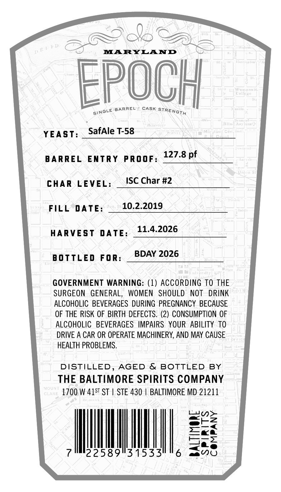
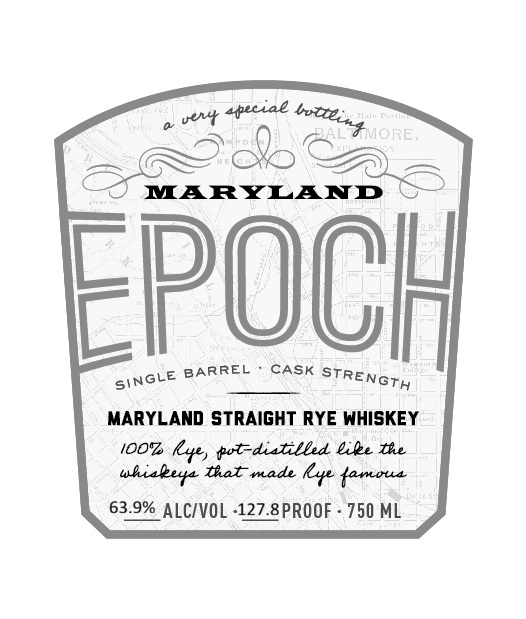

# TTB COLA Label Images - TTBID 26309001000321

**Brand Name:** EPOCH

**Issue Date:** 11/10/2026

**Origin Code:** 25

**Product Class/Type:** 102

**Source:** [TTB Public COLA Registry](https://ttbonline.gov/colasonline/viewColaDetails.do?action=publicFormDisplay&ttbid=26309001000321)

## Label Images

### Back Label

### Front Label

### Label 3

## Extracted Label Text

*Text extracted via OCR - may contain errors*

*1 image(s) excluded: text did not meet readability threshold*

**Detected Proof:** 127.8

### Back Label

BS

GOA

Yak

MARYLAND

EPOCH

NOLE BARREL CASK TT

YEAST

‘safAle T-58

BARREL ENTRY PROOF

127.8 pf

CHAR LEVEL

ISC Char #2

FILL DATE

10.2.2019

HARVEST DATE

11.4.2026

BOTTLED FOR

BDAY 2026

GOVERNMENT WARNING: (1) ACCORDING TO THE

SURGEON GENERAL, WOMEN SHOULD NOT DRINK

ALCOHOLIC BEVERAGES DURING PREGNANCY BECAUSE

OF THE RISK OF BIRTH DEFECTS. (2) CONSUMPTION OF

ALCOHOLIC BEVERAGES IMPAIRS YOUR ABILITY TO

DRIVE A CAR OR OPERATE MACHINERY, AND MAY CAUSE

HEALTH PROBLEMS.

DISTILLED, AGED & BOTTLED BY

THE BALTIMORE SPIRITS COMPANY

1700 W 415" ST | STE 430 | BALTIMORE MD 21211

n>

awtZ

i

<a

NMI

——e

aa O

### Front Label

vevt 4peciae
MARYLAND
Epooh
BARREL
CASK
MARYLAND strAIGHT RYE WHISKEY
iOOz
l, tt-ditilbd &ile te
tal made
Lyne {amoua
63.9% ALCIVOL -127.8PROOF
750 ML
botteint ORE:
STRENGTH
SINGLE
uhiaeer
