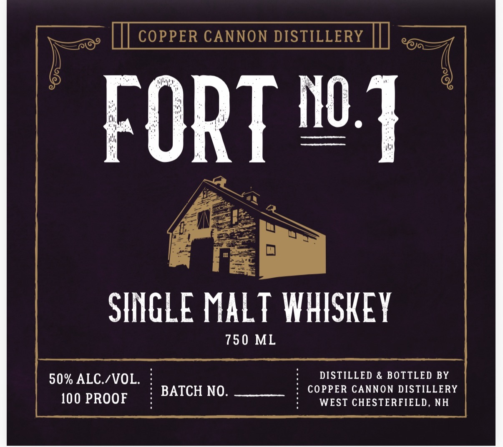
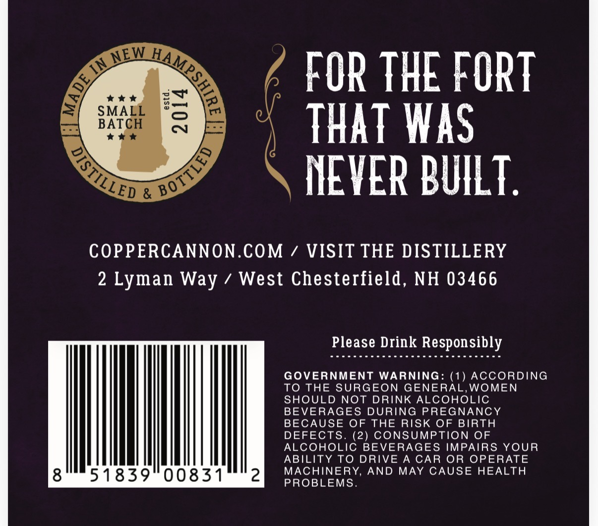

# TTB COLA Label Images - TTBID 26309001000340

**Brand Name:** FORT NO. 1

**Issue Date:** 11/16/2026

**Origin Code:** 33

**Product Class/Type:** 140

**Source:** [TTB Public COLA Registry](https://ttbonline.gov/colasonline/viewColaDetails.do?action=publicFormDisplay&ttbid=26309001000340)

## Label Images

### Label 1

### Label 2

## Extracted Label Text

*Text extracted via OCR - may contain errors*

**Detected Proof:** 100

### Label 1

COPPER CANNON DISTILLERY
FORT no:]
SINGLE MALT WHISKEY
750 ML
50% ALC./VOL.
DISTILLED & BOTTLED BY
BATCH NO.
COPPER CANNON DISTILLERY
100 PROOF
WEST CHESTERFIELD , NH

### Label 2

SS

EW Hays

on

é FOR THE FORT

wk

Pw

SMALL

| BATCH

week

THAT WAS

(

NEVER BUILT.

COPPERCANNON.COM / VISIT THE DISTILLERY

2 Lyman Way / West Chesterfield, NH 03466

Please Drink Responsibly

Ape SHO an SRS ACHES ASE Sates e

GOVERNMENT WARNING: (1) ACCORDING

TO THE SURGEON GENERAL,WOMEN

SHOULD NOT DRINK ALCOHOLIC

BECAUSE OF THE RISK OF BIRTH

BEVERAGES DURING PREGNANCY

DEFECTS. (2) CONSUMPTION OF

ALCOHOLIC BEVERAGES IMPAIRS YOUR

ABILITY TO DRIVE A CAR OR OPERATE

MACHINERY, AND MAY CAUSE HEALTH

IMI

PROBLEMS.
