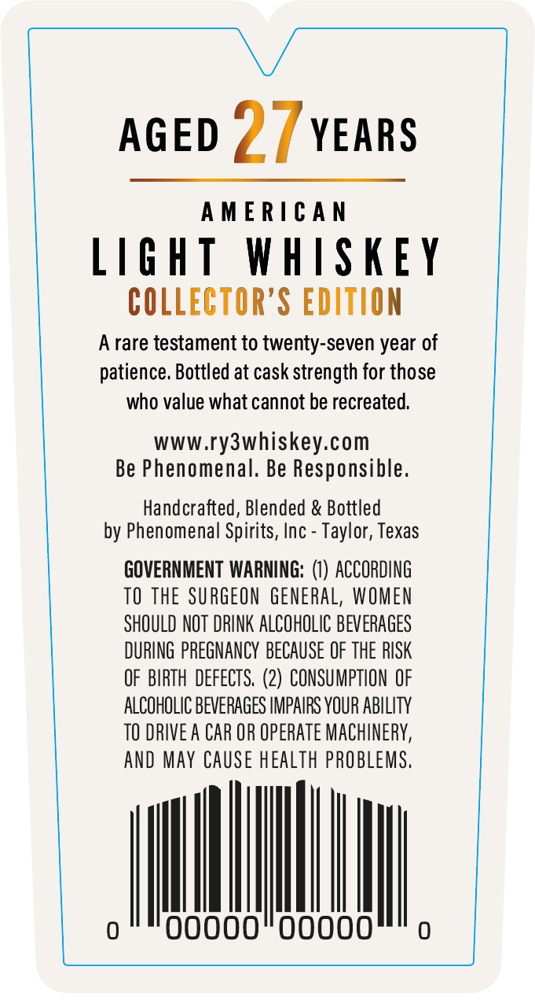
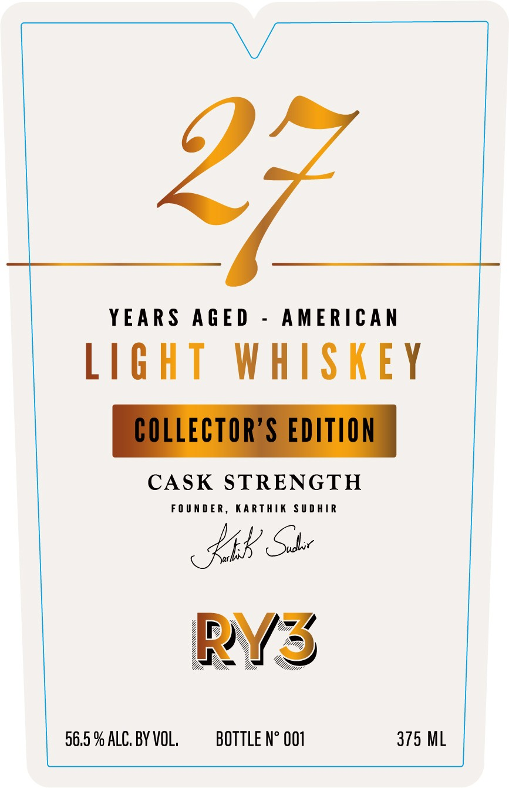
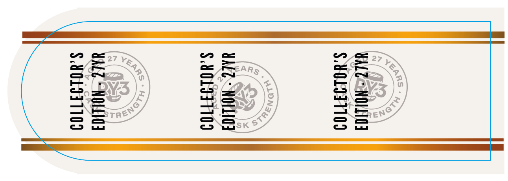

# TTB COLA Label Images - TTBID 26309001000447

**Brand Name:** RY3

**Issue Date:** 11/16/2026

**Origin Code:** 44

**Product Class/Type:** 144

**Source:** [TTB Public COLA Registry](https://ttbonline.gov/colasonline/viewColaDetails.do?action=publicFormDisplay&ttbid=26309001000447)

## Label Images

### Back Label

### Label 1

### Label 3

## Extracted Label Text

*Text extracted via OCR - may contain errors*

*1 image(s) excluded: text did not meet readability threshold*

**Detected Age:** 27 Years

### Back Label

AGED
27YEARs
A MERICA N
LiGHT
W HISkey
COLLECTOR'S EDITION
A rare testament to twenty-seven year of
patience. Bottled at cask strength for those
who value what cannot be recreated.
WWW.ry3whiskey com
Be Phenomenal. Be Responsible:
Handcrafted, Blended & Bottled
by Phenomenal Spirits, Inc - Taylor, Texas
GOVERNMENT WARNING: () ACCORDING
TO ThE SURGEON GENERAL, WOMEN
SHOULD NOT DRINK ALCOHOLIC BEVERAGES
DURING PREGNANCY  BECAUSE OF THE RISK
OF BIRTH  DEFECTS.  (2)  CONSUMPTION OF
ALCOHOLIC BEVERAGES IMPAIRS YOUR ABILITY
TO DRIVE A CAR OR OpeRATe MACHINERY,
AND May CAUSE HeALTH PROBleMS,

### Label 1

27
YEARS
AGED
AMERICAN
LighT
W HISKEY
COLLECTOR'S EDITLON
CASK STRENGTH
Fo Un DER.
Karthik SudhIr
XK Ss
RY3
56.,5 % ALC BY VOL,
BOTTLe N? 001
375 ML
