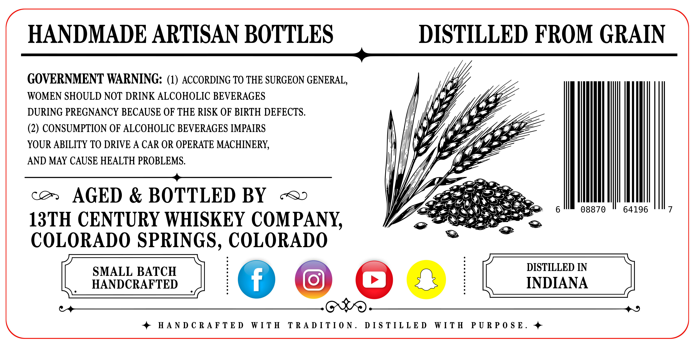
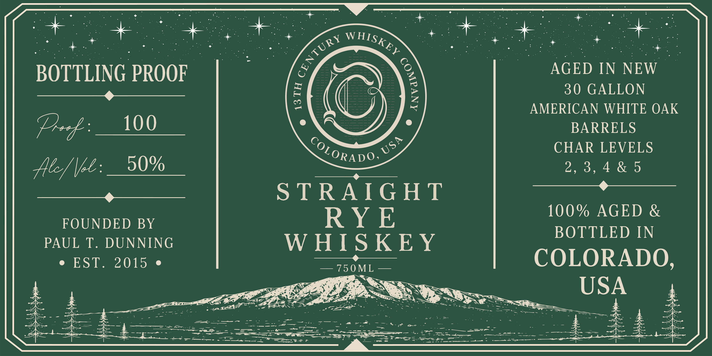

# TTB COLA Label Images - TTBID 26309001000575

**Brand Name:** 13TH CENTURY WHISKEY COMPANY

**Issue Date:** 11/10/2026

**Origin Code:** 13

**Product Class/Type:** 102

**Source:** [TTB Public COLA Registry](https://ttbonline.gov/colasonline/viewColaDetails.do?action=publicFormDisplay&ttbid=26309001000575)

## Label Images

### Back Label

### Front Label

## Extracted Label Text

*Text extracted via OCR - may contain errors*

**Detected Proof:** 100

### Back Label

HANDMADE ARTISAN BOTTLES DISTILLED FROM GRAIN
——$—

WOMEN SHOULD NOT DRINK ALCOHOLIC BEVERAGES

DURING PREGNANCY BECAUSE OF THE RISK OF BIRTH DEFECTS.
(2) CONSUMPTION OF ALCOHOLIC BEVERAGES IMPAIRS

YOUR ABILITY TO DRIVE A CAR OR OPERATE MACHINERY,

AND MAY CAUSE HEALTH PROBLEMS.

GOVERNMENT WARNING: (1) ACCORDING TO THE SURGEON GENERAL, a)

co. AGED & BOTTLED BY «<

13TH CENTURY WHISKEY COMPANY,
COLORADO SPRINGS, COLORADO

[SMALL parce BATCH [NDNA IN
[SMALL parce IN [NDNA

+ HANDCRAFTED WITH TRADITION. DISTILLED WITH PURPOSE. +

08870 64196 7

### Front Label

BOTTLING PROOF
AGED IN
NEW
F
30 GALLON
~
AMERICAN WHITE OAK
Pr& :_
100
BARRELS
CHAR LEVELS
Ae/ Ve:_
50%
2 , 3 , 4 & 5
S TRAIG HT
RY E
100 % AGED &
FOUNDED BY
BOTTLED IN
PAUL T.
DUNNING
W HIS KEY
EST.
2015
750 ML
COLORADO,
USA
2
327
~Sn_
WHISKEY
CENTURY
1
USA
CoLORADO _
4424
