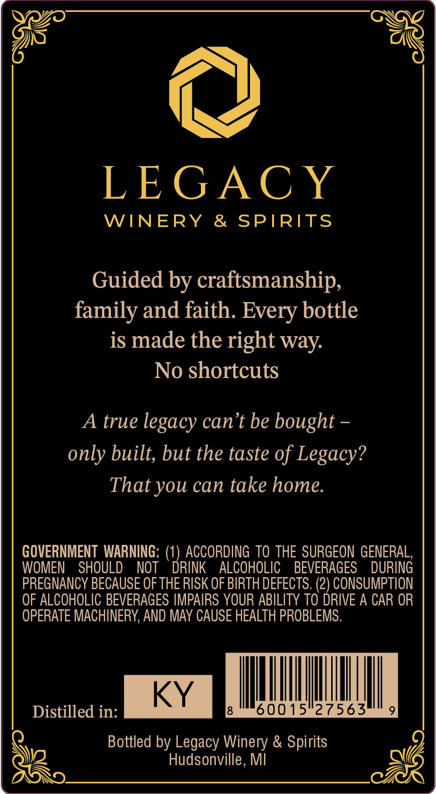
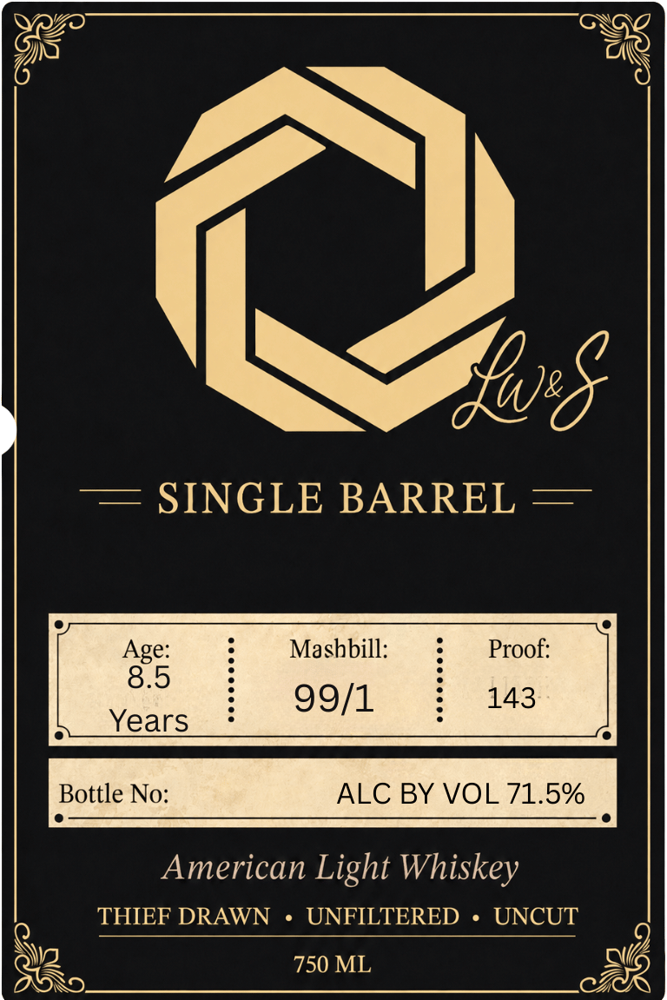

# TTB COLA Label Images - TTBID 26309001000633

**Brand Name:** LW&S

**Issue Date:** 11/19/2026

**Origin Code:** 06

**Product Class/Type:** 144

**Source:** [TTB Public COLA Registry](https://ttbonline.gov/colasonline/viewColaDetails.do?action=publicFormDisplay&ttbid=26309001000633)

## Label Images

### Back Label

### Label 1

## Extracted Label Text

*Text extracted via OCR - may contain errors*

**Detected Proof:** 143

### Back Label

LEGAC Y
WINERY
& SPIRITS
Guided by craftsmanship;
family and faith: Every bottle
is made the right way:
No shortcuts
A true
legacy can't be bought
only built, but the taste of Legacy?
That you can take home.
GOVERNMENT  WARNING:
ACCORDING TO THE SURGEON GENERAL,
WOMEN
SHOULD
NOT
DRINK
ALCOHOLIC
BEVERAGES
DURING
PREGNANCY BECAUSE OF THE RISK OF BIRTH DEFECTS. (2) CONSUMPTION
OF ALCOHOLIC BEVERAGES IMPAIRS YOUR ABILITY TO DRIVE A CAR OR
OPERATE MACHINERY, AND MAY CAUSE HEALTH PROBLEMS:
KY
Distilled in:
60015"27563
Bottled by Legacy Winery & Spirits
Hudsonville , MI

### Label 1

SINGLE BARREL
Age:
Mashbill:
Proof:
8.5
99/1
143
Years
Bottle No:
ALC BY VOL 71.5%
American Light Whiskey
THIEF DRAWN
UNFILTERED
UNCUT
750 ML
