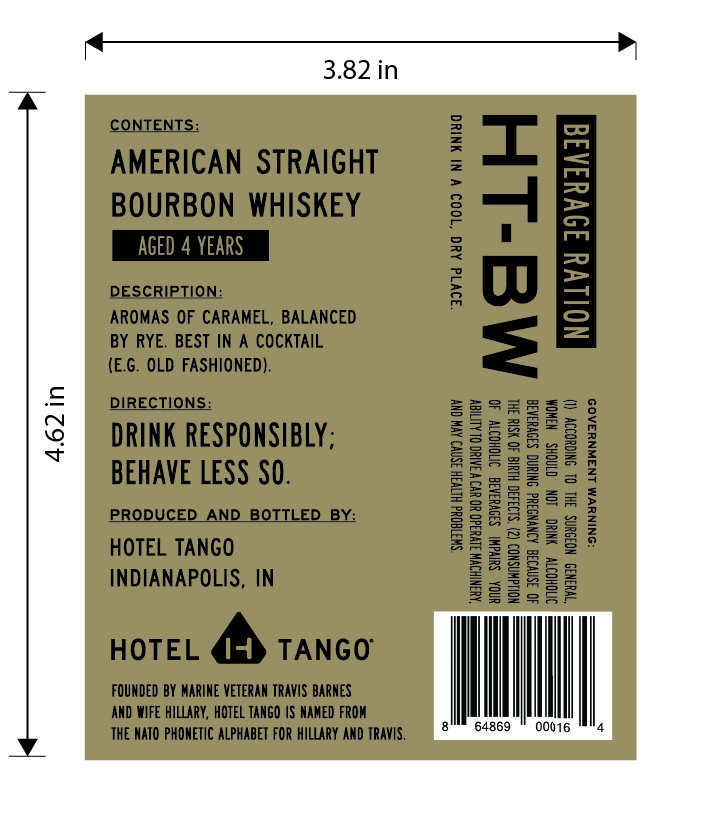
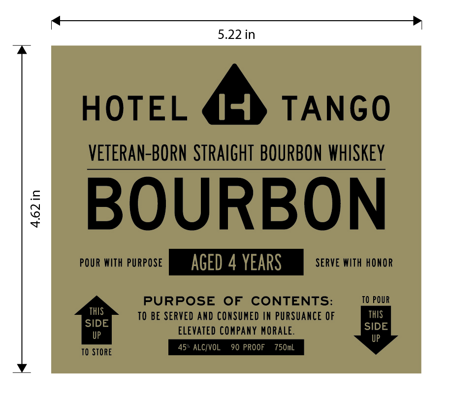

# TTB COLA Label Images - TTBID 26309001000678

**Brand Name:** HOTEL TANGO

**Fanciful Name:** 4 YEAR BOURBON

**Issue Date:** 11/10/2026

**Origin Code:** 19

**Product Class/Type:** 101

**Source:** [TTB Public COLA Registry](https://ttbonline.gov/colasonline/viewColaDetails.do?action=publicFormDisplay&ttbid=26309001000678)

## Label Images

### Back Label

### Front Label

## Extracted Label Text

*Text extracted via OCR - may contain errors*

**Detected Proof:** 90
**Detected Age:** 4 Years

### Back Label

CONTENTS:
1
AMERICAN STRAIGHT
BOURBON WHISKEY
2
1
AGED 4 YEARS
8
3
RRGERS OFOCARAMEL; BALANCED
;
1
BY RYE. BEST IN A COCKTAIL
(EG. OLD FASHIONED)
DIRECTIONS:
4
DRINK RESPONSIBLY;
AHHH
1
BEHAVE LESS SO.
1
#j2
PRODUCED_
AND
BOTTL
1
Ii
1
3
8
Il
HOTEL TanGO
1
INDIANAPOLIS, IN
2
Ii
0p
HOTEL
TANGO
FQUNDED BY MARINe VETERAM TRavIS BarneS
AnD WIFE hillary, HOTEL TaNGO |S NAMEd FROM
THE NATO PHONETIC ALPHAbET FOR hillary AND Travis,
64869
00016

### Front Label

HOTEL
14
TANGO
VETERAN-BORN  STRAIGHT  BOURBON  WHISKEY
BOURBON
POUR With PURPOSE
AGED 4 YEARS
SERVE WIth HONOR
PURPOSE
OF
CONTENTS:
TO POUR
THIS
TO BE SERVED And CONSUMED IN PURSUANCE OF
ThIS
SIDE
SIDE
UP
Elevated Company MORALE:
UP
TO STORe
45" ALCIVOL
90 PROOF
750mL
