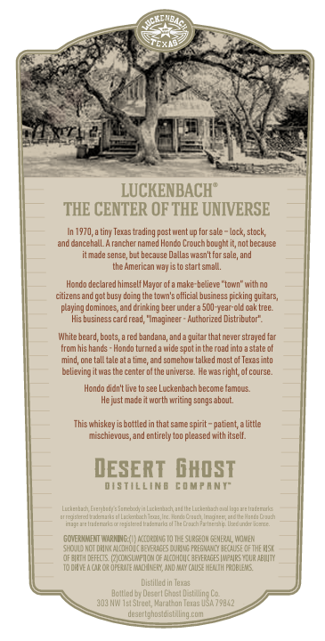
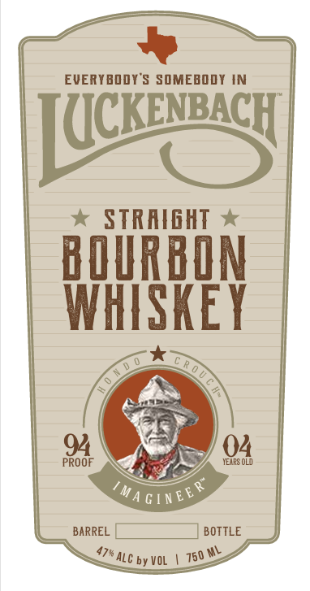

# TTB COLA Label Images - TTBID 26309001000699

**Brand Name:** LUCKENBACH

**Issue Date:** 11/16/2026

**Origin Code:** 44

**Product Class/Type:** 101

**Source:** [TTB Public COLA Registry](https://ttbonline.gov/colasonline/viewColaDetails.do?action=publicFormDisplay&ttbid=26309001000699)

## Label Images

### Back Label

### Front Label

## Extracted Label Text

*Text extracted via OCR - may contain errors*

### Back Label

ITCL
LUCKENBACH"
THE CENTER OF THE UNIVERSE
Un 1970,2 tiny
Texas trading postwentup for sale -
lcck, stock
and dancehalL
rancher named Hondo Crouchbougha it,not because
inmade Sen : Ranuihe cnise Ia Maswasntfor saleani
the American wayisto start small;
Hondo declared himself Mayor ofa make-belicte'
Wiin no
ciizensand gotbusy dcing the toarn's ofiicial business pickin g guntars,
playing dominpes and drinking beer under a SCD-jear-old cak tree
His hicine caro ream
'Imaqineer
Authorzed Distributor".
White bcard
3 redenan danaand3numa cihatnawer straucdnar
from his hands - Hondo turned a wide spctin theroad into a state of
mind,one tall tale ata tme;and somehow talked most of Texas into
believingitwas the center oithe universe  He nasright; ofcourse
Hond D didn't Live to see Lucken bach become famous
Hejust made i werth writing songs about:
This Whiskey is bctiledin that same s pirit = patient; & little
mischievous,and entirely too plcased with itsc |f.
DESERT GHOST
DISTiLLIND WdmpamT"
Mc FTI7 I
F5HeTD TUS Wzonhecte
LctcDC WcT
Mirj Crauh
ci TIE Lrarh - 1
GONER MMENT WARNING (U) Micoeinsto IFe SUrSEON & NEPIL WOVEN
SFLJIDAL ueL SAMMhLUE PRL-FSWJek
FRFGMLS IX BeCAUSE Ofthe MSU
DF eirth defects (2JCCRSUWP1O4 @F ALCoHDUC zeerlces |MPAIRS Piur pBMUTY
IuavE AorWUrbuI: muuNML
chg HeATH ernpicut
Dislillec In Texz:
Bc ILLed =y Deszt| Cnosi Delllin
J03 NW Isl Slreet, Haralhun Texas USA 79042
uusuf lalivsiuisl_u.Cuic
"louin

### Front Label

EVERY BDDY'S SOMEBODY IN
STRAIGHT
BQHRBON
WHISKE Y
9
PROOF
YEARS OLD
BARREL
BOTTLE
47* ALC [
760 ML
by VOL
[UJCKENBACH
'MAGInEER
