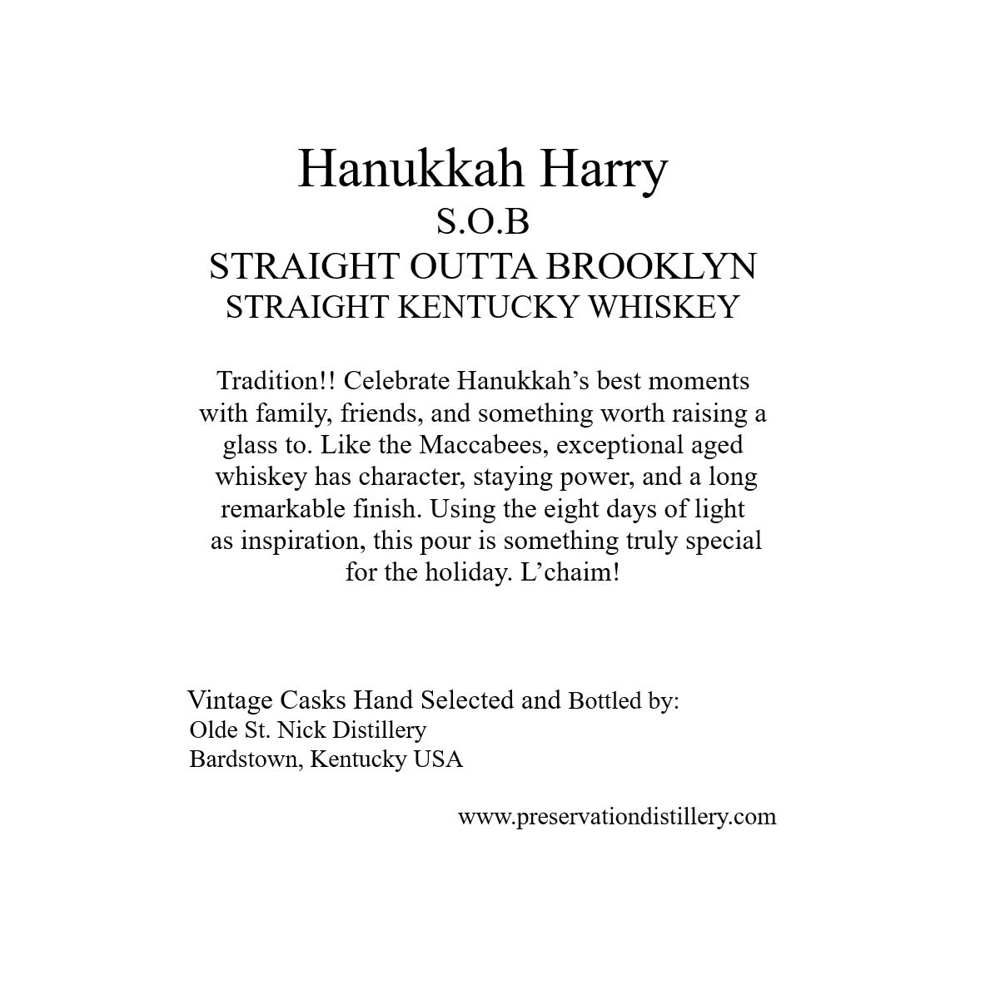
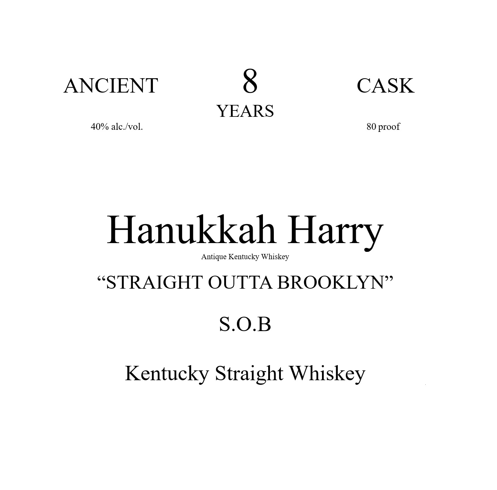
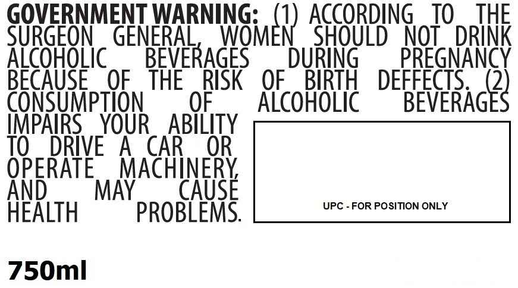

# TTB COLA Label Images - TTBID 26309001000727

**Brand Name:** HANUKKAH HARRY

**Issue Date:** 11/12/2026

**Origin Code:** 22

**Product Class/Type:** 100

**Source:** [TTB Public COLA Registry](https://ttbonline.gov/colasonline/viewColaDetails.do?action=publicFormDisplay&ttbid=26309001000727)

## Label Images

### Back Label

### Label 1

### Label 3

### Label 4

## Extracted Label Text

*Text extracted via OCR - may contain errors*

**Detected Proof:** 80

### Back Label

Hanukkah
S.O.B
STRAIGHT OUTTA BROOKLYN
STRAIGHT KENTUCKY WHISKEY
Tradition! ! Celebrate Hanukkah s best moments
with family, friends, and something worth raising a
glass to. Like the Maccabees, exceptional
whiskey has character; staying power; and a
remarkable finish. Using the eight days of light
as
inspiration, this pour is something truly
for the holiday: L chaim!
Vintage Casks Hand Selected and Bottled by:
Olde St: Nick Distillery
Bardstown, Kentucky USA
www preservationdistillery.com
Harry
aged
long
special

### Label 1

ANCIENT
8
CASK
YEARS
40%/ alc Ivol.
80 proof
Hanukkah Harry
Antique Kentucky Whiskey
SSTRAIGHT OUTTA BROOKLYN
S.O.B
Kentucky Straight Whiskey

### Label 3

Barrel Number:

Private Barrel Pick for:

1234

A.B.C. Wine & Spirits

### Label 4

GOVERNMENT WARNING:
ACCORDING
TO
THE
SURGEON
GENERAL
INGmEr) AGOBD8
NOT
DRINK
AicoHoLic
BEVERAGES
DURiNG
PREGNANCY
BECAUSE
OF
THE
RISK
OF
BIRTH
DEFFECTS
2
CONSUMpTION
OF
AlcohoLic
BEVERAGES
IMPAIRS
YOUR
ABILITY
TO
DRIVE
A
CAR
OR
OPERATE
MACHINERY
And
MAY
CAUSE
UPC - FOR POSITION ONLY
HeALTH
PROBLEMS
750ml
