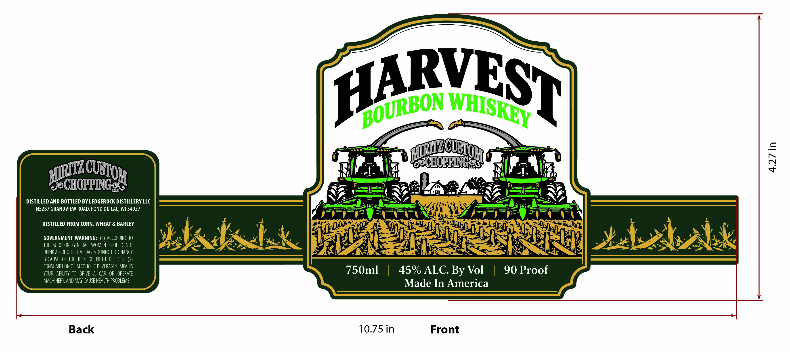

# TTB COLA Label Images - TTBID 26309001000739

**Brand Name:** HARVEST BOURBON WHISKEY

**Issue Date:** 11/10/2026

**Origin Code:** 48

**Product Class/Type:** 141

**Source:** [TTB Public COLA Registry](https://ttbonline.gov/colasonline/viewColaDetails.do?action=publicFormDisplay&ttbid=26309001000739)

## Label Images

### Label 1

## Extracted Label Text

*Text extracted via OCR - may contain errors*

**Detected Proof:** 90

### Label 1

QWwm
nus
DISTILLED AND BOTTLED BY LEDGEROCK DISTILLERY LLC
N5287 GRANDVIEW ROAD; FOND DU LAC, WI 54937
DISTILLED FROM CORN, WHEAT & BARLEY
GOVERNMENT WARNING:
ACCORDING TO
THE   SURGEON   GENERAL, WoMEn   SHOULD  NOT
DRINK ALCOHOLIC BEVERAGES DURING PREGNANCY
BECAUSE   OF THE  RISK  OF   BIRTH  DEFECTS.
CONSUMPTION OF ALCOHOLIC BEVERAGES IMPAIRS
YOUR   ABILITY To   DRIVE
A CAR  OR   OPERATE
750ml
45% ALC: By Vol
90 Proof
MACHINERY, AND May CAUSE HEALTH PROBLEMS:
Made In America
BBOURBON
WHISKEY 7
MiRIZC
