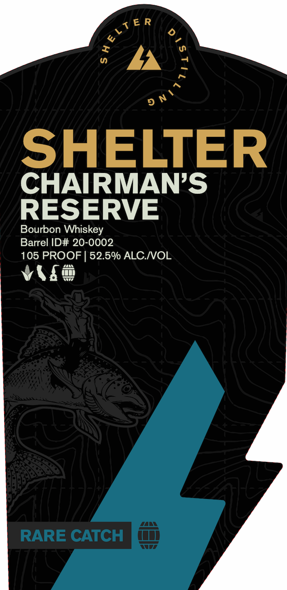
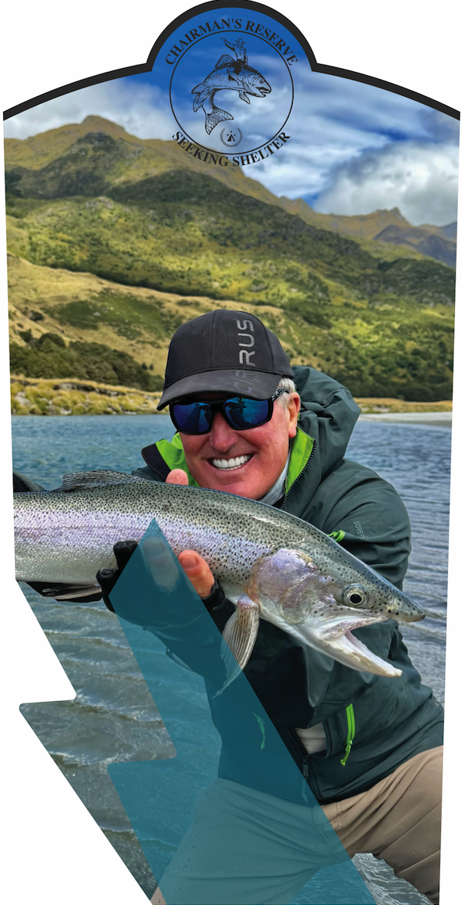
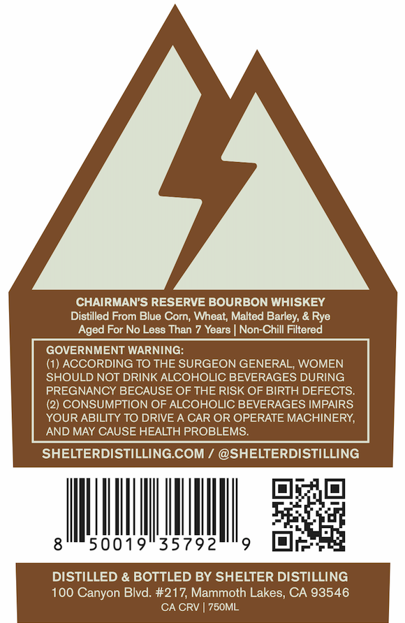

# TTB COLA Label Images - TTBID 26310001000026

**Brand Name:** SHELTER

**Fanciful Name:** CHAIRMANS'S RESERVE

**Issue Date:** 11/10/2026

**Origin Code:** 01

**Product Class/Type:** 141

**Source:** [TTB Public COLA Registry](https://ttbonline.gov/colasonline/viewColaDetails.do?action=publicFormDisplay&ttbid=26310001000026)

## Label Images

### Label 1

### Label 2

### Label 3

### Label 4

## Extracted Label Text

*Text extracted via OCR - may contain errors*

*2 image(s) excluded: text did not meet readability threshold*

**Detected Proof:** 105
**Detected Age:** 7 Years

### Label 1

4
SHELTER
CHAIRMANS
RESERVE
Bourbon Whiskey
Barrel ID# 20-0002
105 PROOF
52.50 ALC IOL
RARE CATCH
$hELTep

### Label 3

CHAIRMAN'S RESERVE BOURBON WHISKEY
Distilled From Blue Corn; Wheat; Malted Barley; & Rye
Aged For No Less Than 7 Years
Non-Chill Filtered
GOVERNMENT WARNING:
(1) ACCORDING TO THE SURGEON GENERAL, WOMEN
SHOULD NOT DRINK ALCOHOLIC BEVERAGES DURING
PREGNANCY BECAUSE OF THE RISK OF BIRTH DEFECTS
CONSUMPTION OF ALCOHOLIC BEVERAGES IMPAIRS
YOUR ABILITY TO DRIVE A CAR OR OPERATE MACHINERY,
AND MAY CAUSE HEALTH PROBLEMS.
SHELTERDISTILLING COM
@SHELTERDISTILLING
50019
35792
DISTILLED & BOTTLED BY SHELTER DISTILLING
100 Canyon Blvd: #217, Mammoth Lakes; CA 93546
CA CRV
75OML
