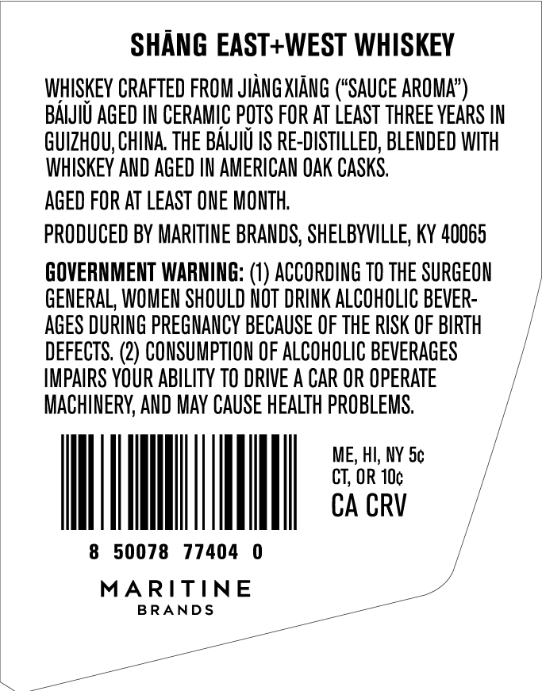
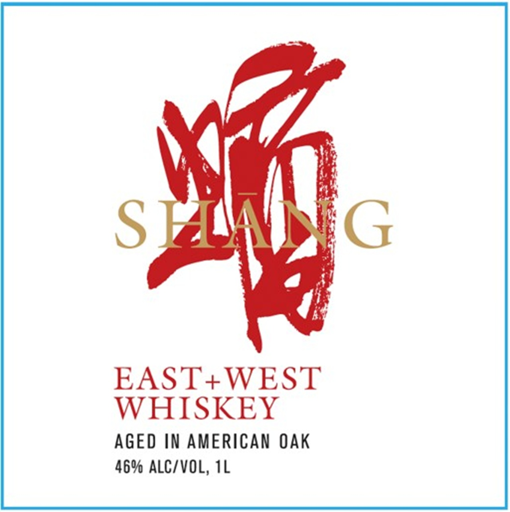

# TTB COLA Label Images - TTBID 26310001000071

**Brand Name:** SHANG

**Fanciful Name:** EAST + WEST

**Issue Date:** 11/12/2026

**Origin Code:** 22

**Product Class/Type:** 140

**Source:** [TTB Public COLA Registry](https://ttbonline.gov/colasonline/viewColaDetails.do?action=publicFormDisplay&ttbid=26310001000071)

## Label Images

### Back Label

### Front Label

### Label 3

## Extracted Label Text

*Text extracted via OCR - may contain errors*

*2 image(s) excluded: text did not meet readability threshold*

### Back Label

SHANG EAST+WEST WHISKEY
WHISKEY CRAFTED FROM JIANG XHANG ("SAUCE AROMA")
BALJi_ AGED IN CERAMIC POTS FOR AT LeaSt thREE YEARS IN
GUIZHOU; CHINA  ThE BALJIU IS RE-DISTILLED; BLENDED WITH
WHISKEY AND AGED IN AMERICAN OAK CASKS,
AGED FOR AT LeAST ONE MONTH;
PRODUCED BY MARITINE BRANDS, SHELBVVILLE, KY 40065
GOVERNMENT WARNING: (1) ACCORDING TO THE SURGEON
GENERAL, WOMEN SHOULD NOT DRINK ALCOHOLIC BEVER-
AGES DURING PREGNANCY BECAUSE OF THE RISK OF BIRTH
DEFECTS. (2) CONSUMPTHON OF ALCOHOLIC BEVERAGES
IMPAIRS YOUR ABILITY TO DRIVE A CAR OR OpeRATe
MACHINERY, AND MAY CAUSE HEALTH PROBLEMS
ME; HI; NY Sc
Ct, OR 1Oc
CA CRV
8
50078
77404
0
MARITINE
BRANDS
