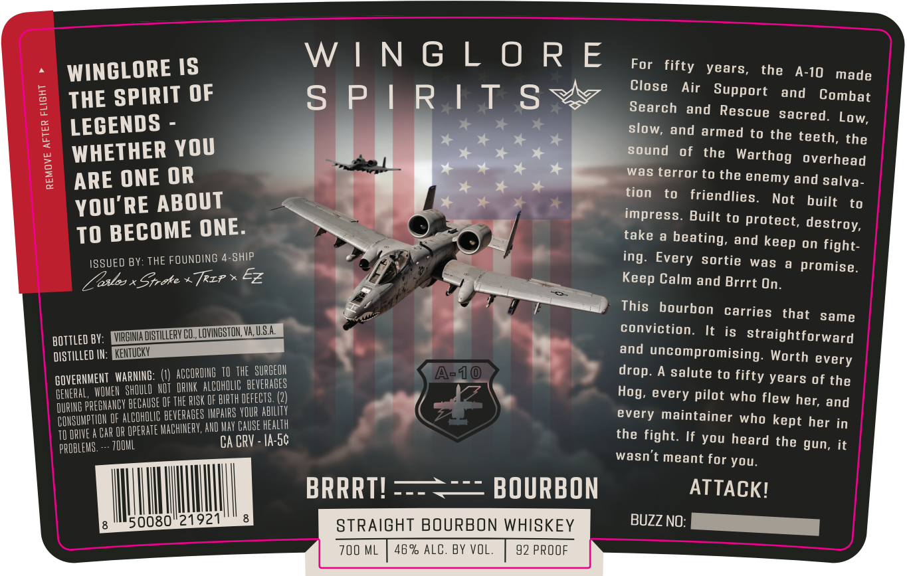

# TTB COLA Label Images - TTBID 26310001000225

**Brand Name:** WINGLORE SPIRITS

**Fanciful Name:** BRRRT! BOURBON

**Issue Date:** 11/10/2026

**Origin Code:** 05

**Product Class/Type:** 101

**Source:** [TTB Public COLA Registry](https://ttbonline.gov/colasonline/viewColaDetails.do?action=publicFormDisplay&ttbid=26310001000225)

## Label Images

### Back Label

## Extracted Label Text

*Text extracted via OCR - may contain errors*

**Detected Proof:** 92

### Back Label

WINGLORE

~ WINGLORE IS

For fifty years,

the A-10 made

=

Close Air

3S

THE SPIRIT OF

SPIRITSW

Support ang Combat

Search and Rescue Sacred. Low,

LEGENDS -

Slow, and armed to the teeth, the

WHETHER YOU

‘ound of the Warthog Overhead

ARE ONE OR

Was terror to the enemy and salva-

tion to friendlies.

YOU'RE ABOUT

Not built to

i}

TO BECOME ONE

impress. Built to Protect, destroy,

take a beating,

and keep on fight.

ISSUED BY: THE FOUNDING 4-SHIP

Vv

x %

ing. Every sortie was a Promise

L alos x Epote «fcr » ©

Keep Calm and Brrrt On.

This bourbon carries that same

fe

7

Conviction.

BOTTLED BY .

It is straightforward

DISTILLED IN

&

and uncompromising. Worth every

GOVERNMENT W

|ARNING

(I) ACCORDING 10 THE SURGEON

BES

drop. A salute to fifty years of the

GENERAL, WOMEN

sttf WO NOT ORINK ALCOHOLIC BEVERA

DURING PREGNANCY BE

CLAUSE OF THE RISK OF BIRTH DEFECTS. (2)

lo

Hog, every pilot who flew her, and

CONSUMPTION OF Al

F ALCOA BEVERAGES IMPAIRS YOUR ABILITY

oy

every maintainer who kept her in

TOORWVE ACAROR

OPERATE MACHINERY, AND Rt CAUSE HEALTH

PROBLENS.

TOOML

- [Aro¢

the fight. If you heard the gun, it

wasn't meant for you.

BRRRT!

BOURBON

ATTACK!

i

ll

Ill

vm

50080 °2

STRAIGHT BOURBON WHISK

BUZZ NO:

700 M

AB%

ALC. BY VOL.

92 PROOF
