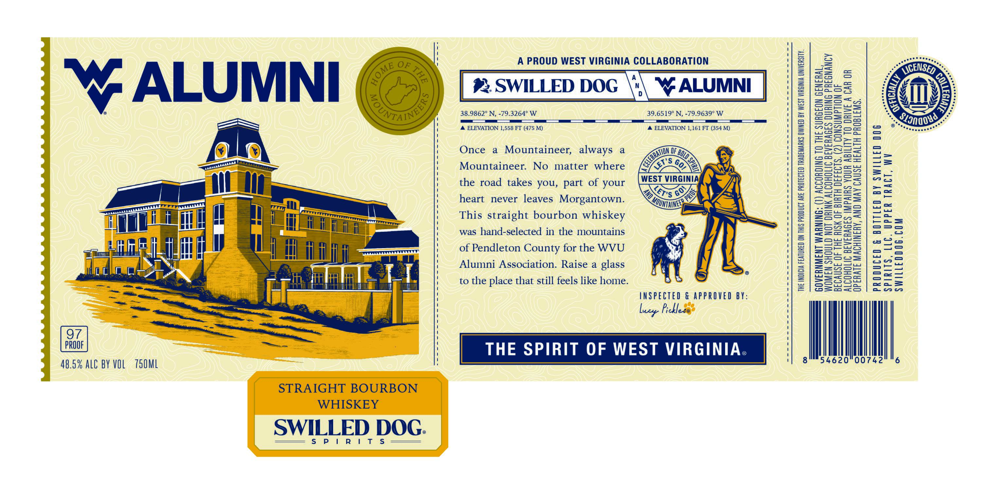

# TTB COLA Label Images - TTBID 26310001000250

**Brand Name:** SWILLED DOG SPIRITS

**Fanciful Name:** WV ALUMNI

**Issue Date:** 11/10/2026

**Origin Code:** 47

**Product Class/Type:** 101

**Source:** [TTB Public COLA Registry](https://ttbonline.gov/colasonline/viewColaDetails.do?action=publicFormDisplay&ttbid=26310001000250)

## Label Images

### Label 1

## Extracted Label Text

*Text extracted via OCR - may contain errors*

**Detected Proof:** 97

### Label 1

A PROUD WEST VIRGINIA COLLABORATION

poten te tes,

5

==

aie

WEEMSEy

en Gor te

-—tio}

3S

Baos

ALUMNI

_% SWILLED DOG \\\ ALUMNI

a es

HI

frey=—

==

Sm

‘O

xy,

S

v

38.9862° N, -79.3264° W

OO

39.6519° N, -79.9639° W

——— a

eoSt=aos

‘A ELEVATION 1,558 FT (475 M)

A ELEVATION 1,161 FT (354 M)

AuRox

—

eo"

Sigs

er prrerrt tis

==

uSs=—o

_—

Once a Mountaineer, always a

SNON OF 2

=o

a

— a

Y)

oa

Zo

Axx

==>

Mountaineer. No matter where

LX

eS

(SE ieee

ee)

S=zoa>S>=

econrs >

les

the road takes you, part of your

Sea

age fe ot we

_=

Safes ae

o=S

ooo

eTPFTTTTY

heart never leaves Morgantown.

Came a

SSO

=OS0

-F

250Cnt

Som tS=

—_s

aa

This straight bourbon whiskey

2eS5>

=

rik

was hand-selected in the mountains

=)

a2

a= Sou

o>a

Sows

nee =|

aS

i

LL

of Pendleton County for the WVU

Si

SSH

=

i uN

api

SS Sco

on

Alumni Association. Raise a glass

—

wu

==

UILAT

LL

we

Ky

{) ®&

=S==0c

(yar

rea

|

Li

I

ml

to the place that still feels like home

S255o

fee Seana

INSPECTED & APPROVED BY:

Lacy Pebledg’

1

Ml

48.5% ALC BY VOL 750ML

|

4620 00742

6

SWILLED DOG.

$P i Ritts
