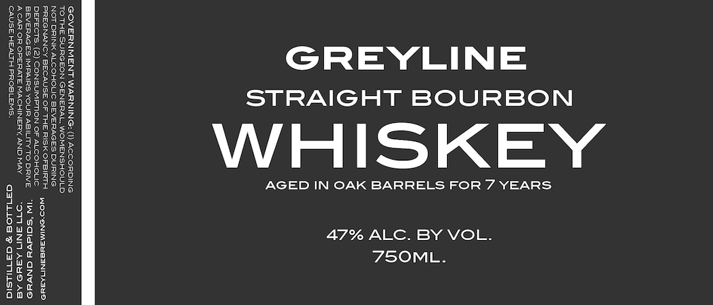

# TTB COLA Label Images - TTBID 26310001000253

**Brand Name:** GREYLINE

**Issue Date:** 11/10/2026

**Origin Code:** 06

**Product Class/Type:** 101

**Source:** [TTB Public COLA Registry](https://ttbonline.gov/colasonline/viewColaDetails.do?action=publicFormDisplay&ttbid=26310001000253)

## Label Images

### Label 1

## Extracted Label Text

*Text extracted via OCR - may contain errors*

**Detected Proof:** 94
**Detected Age:** 7 Years

### Label 1

AGED IN OAK BARRELS FOR 7 YEARS
47% ALC. BY VOL.
7SOML.

GREYLINE
STRAIGHT BOURBON

WHISKEY

GOVERNMENT WARNING: () AccoRDING
TOTHE SURGEON GENERAL, WOMENSHOULD

PREGNANCY BECAUSE OF THERISKOFBIRTH woo-onunaugaNmAsu
DEFECTS, (2) CONSUMPTION OF ALCOHOLIC "

BEVERAGES IMPAIRS YOURAGILITYTODRIVE “IW ‘SCicvel GNVHO.
ACAR OROPERATE MACHINERY,ANDMAY “77 BNI ASH AS.
‘CAUSE HEALTH PROBLEMS. GERUNDS SE MLS
