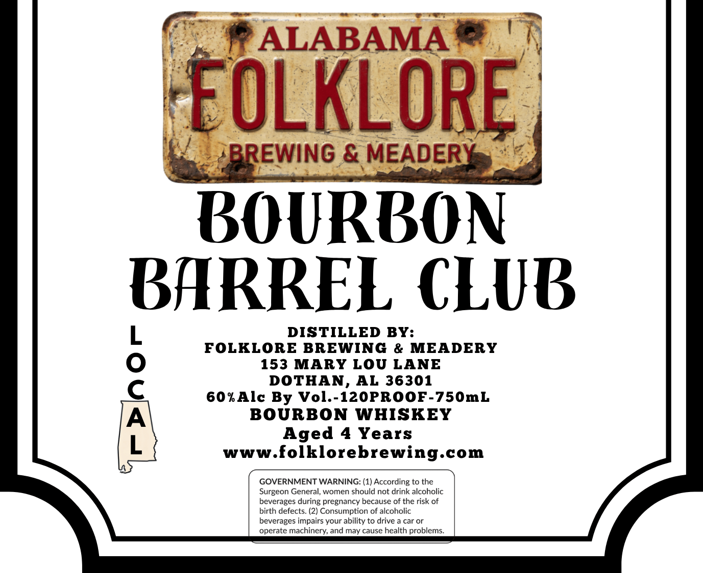
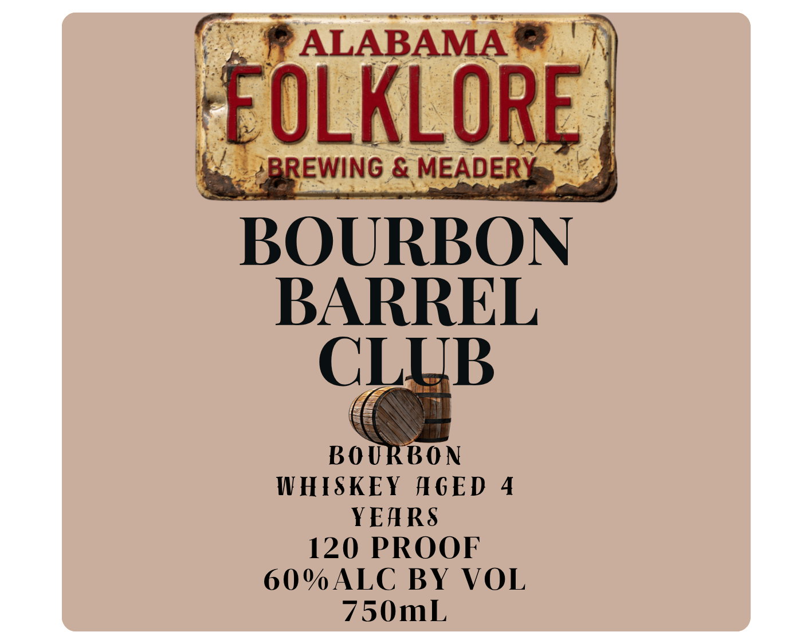

# TTB COLA Label Images - TTBID 26310001000273

**Brand Name:** BOURBON BARREL CLUB

**Issue Date:** 11/13/2026

**Origin Code:** 10

**Product Class/Type:** 141

**Source:** [TTB Public COLA Registry](https://ttbonline.gov/colasonline/viewColaDetails.do?action=publicFormDisplay&ttbid=26310001000273)

## Label Images

### Back Label

### Front Label

## Extracted Label Text

*Text extracted via OCR - may contain errors*

**Detected Proof:** 120
**Detected Age:** 4 Years

### Back Label

ALABAMA
EOLKLORE
BREWING & MEADERY
BOURBon
BHRREL CLUB
DISTILLED BY:
FOLKLORE BREWING &
MEADERY
153 MARY LOU LANE
DOTHAN, AL 36301
1
602 ABOJRBONZO POE OnL
Aged
4
Years
www.folklorebrewing.com
GOVERNMENT WARNING: (1) According to the
Surgeon General, women should not drink alcoholic
beverages during pregnancy because of the risk of
birth defects. (27
Consumption of alcoholic
beverages impairs your ability to drive
car Or
operate machinery, and may cause health problems

### Front Label

ALABAMA
EOLKLORE
BREWING & MEADERY
BOURBON
BARREL
CLUB
BO URBON
W HISKEY
AGED
4
YEARS
120 PROOF
60 %ALC BY VOL
750mL
