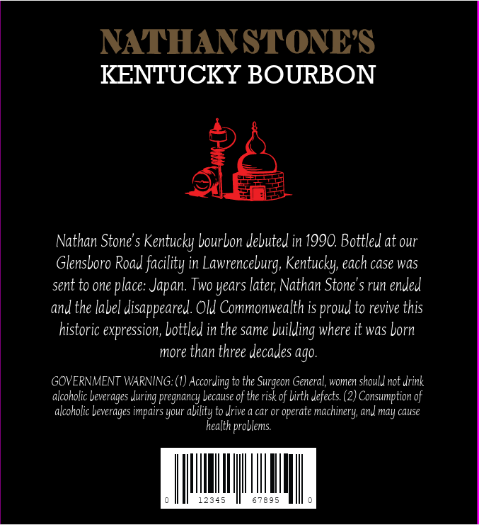
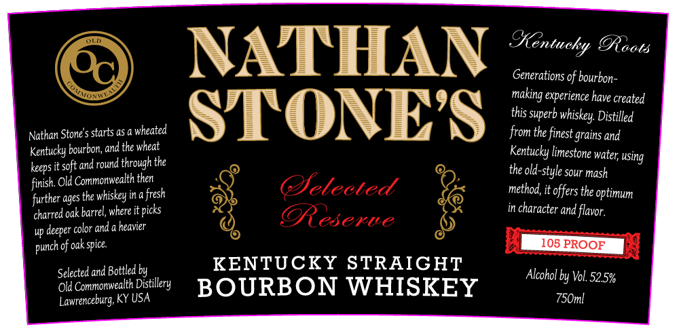
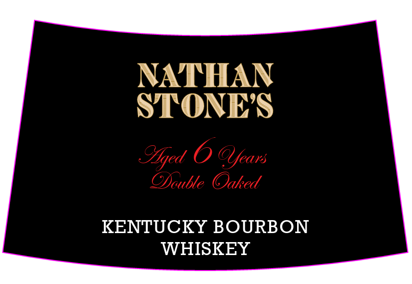

# TTB COLA Label Images - TTBID 26310001000323

**Brand Name:** NATHAN STONE'S

**Issue Date:** 11/17/2026

**Origin Code:** 22

**Product Class/Type:** 101

**Source:** [TTB Public COLA Registry](https://ttbonline.gov/colasonline/viewColaDetails.do?action=publicFormDisplay&ttbid=26310001000323)

## Label Images

### Back Label

### Front Label

### Label 3

## Extracted Label Text

*Text extracted via OCR - may contain errors*

### Back Label

NATHANSTONES
KENTUCKY BOURBON
Nathan Stone $
Kentucky bourbon debuted in 1990. Bottled at our
Glensboro Road facility in Lawrenceburg Kentucky; each case was
sent to one place:
Two years later; Nathan Stone' $ run enled
and the label disappeared. Ol Commonwealth is
to revive this
historic expression, bottled in the same
builling where it was born
more than three Jecadles ago:
GOVERNMENT WARNING: (1) Accor Jing to the
General, women shoul not rink
akcoholic beverages luring pregnancy because of the risk of birth Jlefects
Consumption of
alcoholic beverages impairs your ability to Jrive
car 0r
operate machinery; andl may cause
health problems:
12345
Japan:
proud
Surgcon =

### Front Label

NATHAN
IRoots
Generations of bourbon -
experience have created
STONES
this superb
Distilled
Nathan Stone
starts aS
wheated
from the finest grains and
Kentucky bourbon; and the wheat
Kentucky limestone water;
keeps
soft
round through the
the old
using
then
~style sour mash
finish Old Commonwealth
fresh
Pfelected
method, it offers the optimum
further
the whiskey in
charred oak barrel, where it picks
OReserve
in character and flavor.
up deeper color and
heavier
of oak spice
108 PRQOF
Selected
Bottled by
KENTUCKY STRAIGHT
Alcohol by Vol. 52.5%
Old Commonwealth Distillery
BOURBON WHISKEY
awrenceburg; KY USA
SKentucky
Ws
making
 whiskey:
and _
ages
punch ,
ana _
750ml

### Label 3

NATHAN
STONES
6 @fears
Oauble Oaked
KENTUCKY BOURBON
WHISKEY
Ifged
