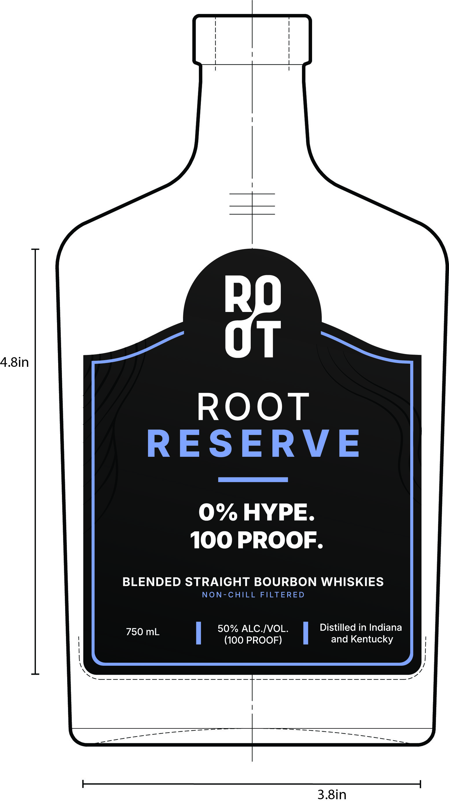
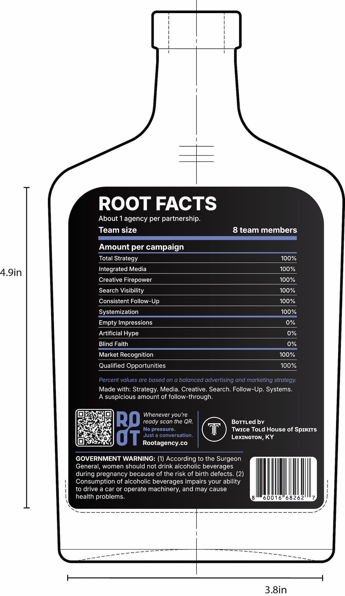

# TTB COLA Label Images - TTBID 26310001000350

**Brand Name:** ROOT RESERVE

**Issue Date:** 11/20/2026

**Origin Code:** 22

**Product Class/Type:** 121

**Source:** [TTB Public COLA Registry](https://ttbonline.gov/colasonline/viewColaDetails.do?action=publicFormDisplay&ttbid=26310001000350)

## Label Images

### Label 1

### Label 2

## Extracted Label Text

*Text extracted via OCR - may contain errors*

**Detected Proof:** 100

### Label 1

RO
0T
Root
RESERVE
0% HYPE.
100 PROOF.
BLENDED STRAIGHT BOURBON WHISKIES
NON-CHILL FILTERED
750 mL
50% ALC IVOL.
Distilled in Indiana
(100 PROOF)
and Kentucky

### Label 2

ROOT FACTS

About 1 agency per partnership.
Team size 8 team members

Amount per campaign
Total Strategy

A.9in Integrated Media
Creative Firepower
Search Visibility
Consistent Follow-Up
Systemization
Empty Impressions
Artificial Hype
Blind Faith
Market Recognition
Qualified Opportunities

Percent values are based adv

Made with: Strategy. Media. Creative. Search. Follow-Up. Systems.
A suspicious amount of follow-through.

Whenever you're

ready scan the QR. BottLed by

No pressure. Twice Totd House of Spirits
T Just a conversation LexIncToON, KY

Rootagency.co

GOVERNMENT WARNING: (1) According to the Surgeon
General, women should not drink alcoholic beverages
during pregnancy because of the risk of birth defects. (2)
Consumption of alcoholic beverages impairs your ability
to drive a car or operate machinery, and may cause
health problems.
