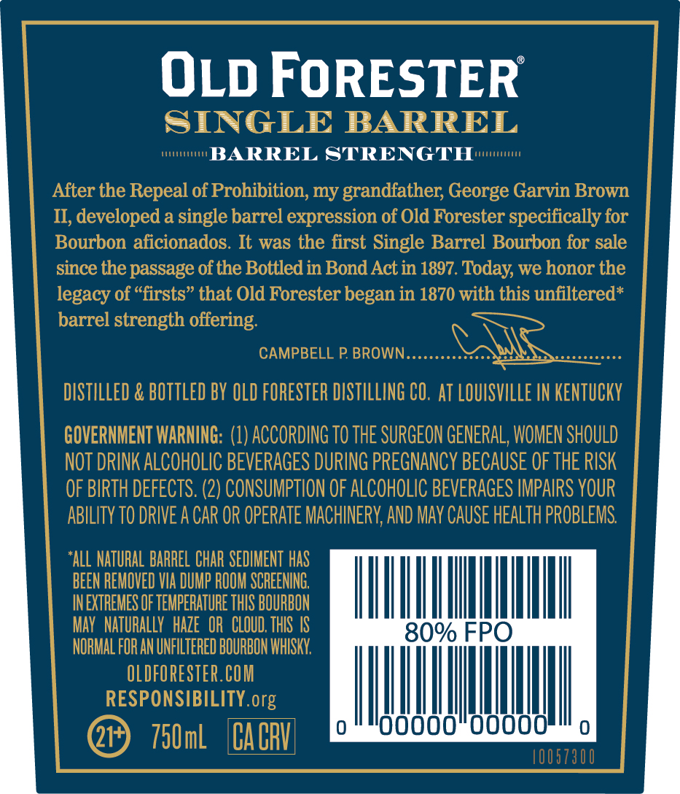
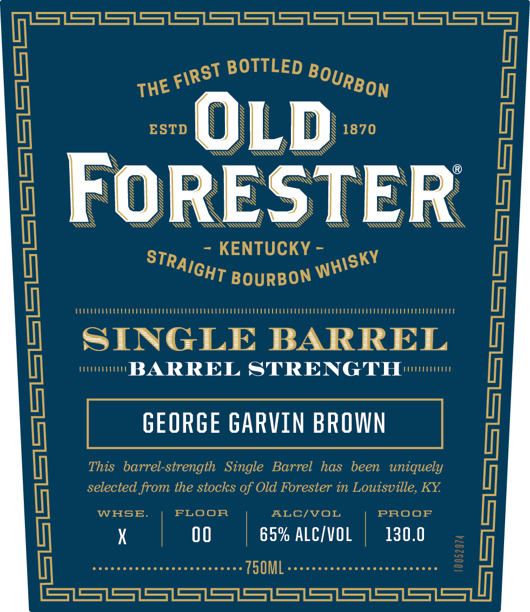
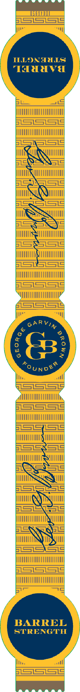

# TTB COLA Label Images - TTBID 26310001000380

**Brand Name:** OLD FORESTER

**Fanciful Name:** SINGLE BARREL BARREL STRENGTH

**Issue Date:** 11/10/2026

**Origin Code:** 22

**Product Class/Type:** 101

**Source:** [TTB Public COLA Registry](https://ttbonline.gov/colasonline/viewColaDetails.do?action=publicFormDisplay&ttbid=26310001000380)

## Label Images

### Back Label

### Front Label

### Label 2

## Extracted Label Text

*Text extracted via OCR - may contain errors*

**Detected Proof:** 130

### Back Label

OLD FORESTER

SINGLE BARREL

unis

BARREL STRENGTH

After the Repeal of Prohibition, my grandfather, George Garvin Brown

II, developed a single barrel expression of Old Forester specifically for

Bourbon aficionados. It was the first Single Barrel Bourbon for sale

since the passage of the Bottled in Bond Act in 1897. Today, we honor the

legacy of “firsts” that Old Forester began in 1870 with this unfiltered*

barrel strength offering.

CAMPBELL P. BROWN

DISTILLED & BOTTLED BY OLD FORESTER DISTILLING CO. AT LOUISVILLE IN KENTUCKY

GOVERNMENT WARNING: (1) ACCORDING TO THE SURGEON GENERAL, WOMEN SHOULD

NOT DRINK ALCOHOLIC BEVERAGES DURING PREGNANCY BECAUSE OF THE RISK

OF BIRTH DEFECTS. (2) CONSUMPTION OF ALCOHOLIC BEVERAGES IMPAIRS YOUR

ABILITY TO DRIVE A CAR OR OPERATE MACHINERY, AND MAY CAUSE HEALTH PROBLEMS.

‘ALL NATURAL BARREL CHAR SEDIMENT HAS

BEEN REMOVED VIA DUMP ROOM SCREENING

IN EXTREMES OF TEMPERATURE THIS BOURBON

ILL

MAY NATURALLY HAZE OR CLOUD. THIS IS

NORMAL FOR AN UNFILTERED BOURBON WHISKY,

OLDFORESTER.COM

RESPONSIBILITY org

wil

ill

|

000000

@P) 750m

100

### Front Label

SZSS1S=7SS7SS1SS7SS7SS7S7SS1S=7S=
D
BOTTLED
|
ESTD
OLD
1870
FoRESTER
KEQUBCON =
1
SINGLE
BARREL
BARREL STRENG TTH
(
This   barrel-strength
GeorGe GARVIN BROWN
been
uniquely
selected from the stocks of Old Forester in Louisville, KY
WHSEE
FLOOR
ALCIVOL
PROOF
|
00
65% ALCIVOL
130.0
750ML
1
SS1S
FIRST
BOURBON
THE
STRAIGHT
WHISKY

### Label 2

O55)

p01

SS

le

uy

BL iS

UNNI LNUUTT UII

I

SSceqe

WINNT TUT

!

SES

INALI

Atl

ae

AS

=

TENT

Ble

INS

—

C=

Wn

>

uh

‘NI

gle

=i

=

wt

Ii

~—

=i.

|

Se We

Hill

ih

SII

=r

SLES

TINIITDSHTUIT

aL

aS US

TM I

LST S515

IUNNTNNUTTUIT

y

qe = a1s

i

I |

GARY,

hye

li

iil

LSS. SS

WUUINNEAN NUIT

hy,

LS.S.5518

WUULUN TANT

LS.=

TIMI IEAL IIT

Lae

p15]

ULI

|

=}

Wir

I

—e

pets|

NUH

Wi

iY

S45

ol

=|

TTT

ELE

IIIT

Dull

==

=

TUTTI TTT

|

1

WUUTTNIENN TTT

I

Nha

all

LS Ste ie
