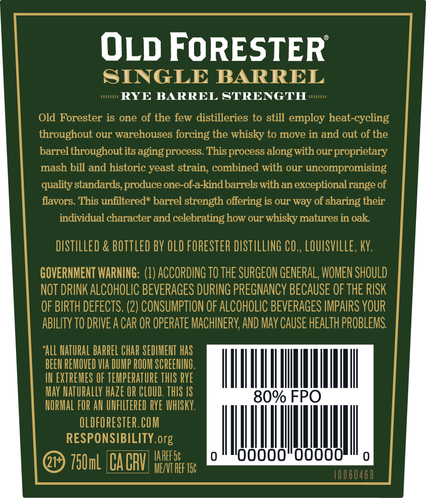
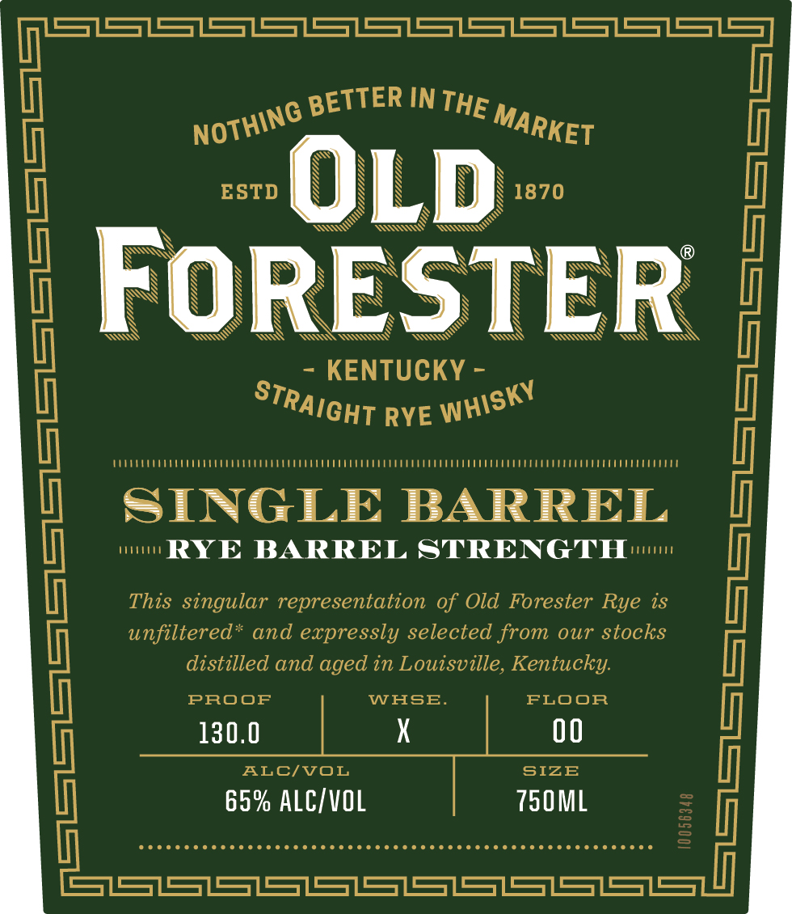
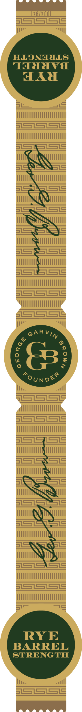

# TTB COLA Label Images - TTBID 26310001000386

**Brand Name:** OLD FORESTER

**Fanciful Name:** SINGLE BARREL RYE BARREL STRENGTH

**Issue Date:** 11/10/2026

**Origin Code:** 22

**Product Class/Type:** 102

**Source:** [TTB Public COLA Registry](https://ttbonline.gov/colasonline/viewColaDetails.do?action=publicFormDisplay&ttbid=26310001000386)

## Label Images

### Back Label

### Front Label

### Label 3

## Extracted Label Text

*Text extracted via OCR - may contain errors*

**Detected Proof:** 130

### Back Label

OLD FORESTER

SINGLE BARREL

Pry

mune

RYE BARREL STRENGTH

Old Forester is one of the few distilleries to still employ heat-cycling

throughout our warehouses forcing the whisky to move in and out of the

barrel throughout its aging process. This process along with our proprietary

mash bill and historic yeast strain, combined with our uncompromising

quality standards, produce one-of-a-kind barrels with an exceptional range of

flavors. This unfiltered* barrel strength offering is our way of sharing their

individual character and celebrating how our whisky matures in oak.

ISTILLED & BOTTLE

Y OLD FORESTER DISTILLING CO., LOUISVILLE, KY

GOVERNMENT WARNING: (1) ACCORDING TO THE SURGEON GENERAL, WOMEN SHOULD

NOT DRINK ALCOHOLIC BEVERAGES DURING PREGNANCY BECAUSE OF THE RISK

OF BIRTH DEFECTS. (2) CONSUMPTION OF ALCOHOLIC BEVERAGES IMPAIRS YOUR

ABILITY TO DRIVE A CAR OR OPERATE MACHINERY, AND MAY CAUSE HEALTH PROBLEMS.

ALL NATURAL BARREL CHAR SEDIMENT HAS

BEEN REMOVED VIA DUM

M SCREENING

IN EXTREMES OF TEMPERATURE THIS RYE

mL

MAY NATURALLY HAZE OR CLO

NN

NORMAL

AN UNFIL

RYE WHISKY.

OLDFORESTER.COM

aripc org

wl

ill

|

TPA Pp] WAREESE

000000

@) 750ml C

Me AEF Tat

### Front Label

S1S1SS1S31S1S31S1S31531S31S15=
IN
ESTD
OLD
1870
FoRESTER
KENTUCKY =
RYE
(
SINGLE
ThJeYvq I AJRMLn
23
1
unfiltered" and expressly selected from our stocks
distilled and aged in Louisville, Kentucky:
PROOF
WHSE
FLOOR
130.0
X
00
ALCIVOL
SIZE
65% ALCIvOL
750ML
1
SISSLSLSLSSLSSLSSLSSIS7
BETTER
THE
NOThinG
MARKET
STRAIGHT
WHISKY

### Label 3

HLONALLS
TaHdava

aA

RYE
BARREL
STRENGTH
