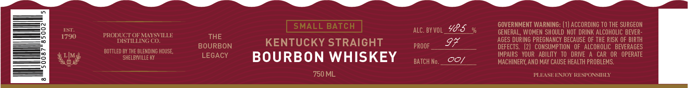
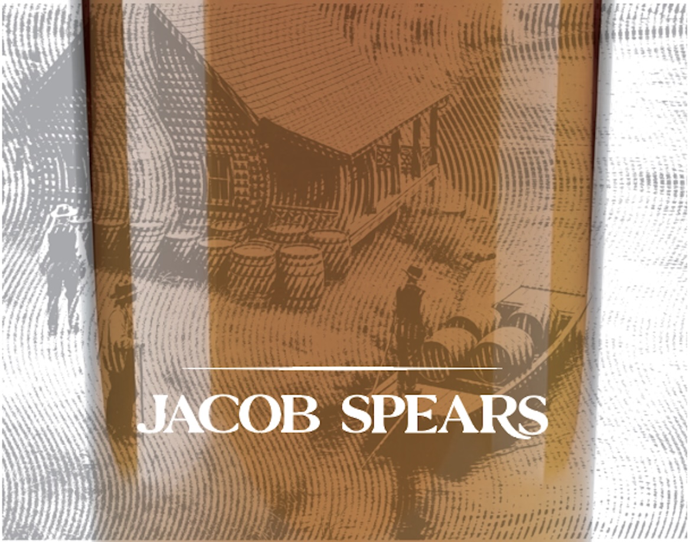
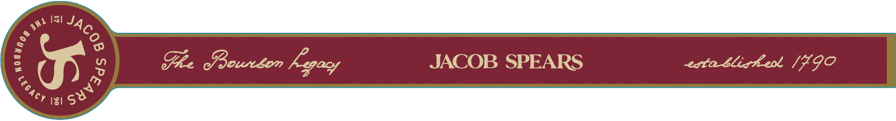
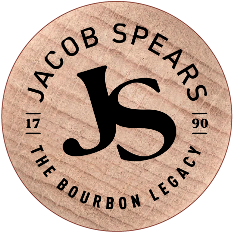

# TTB COLA Label Images - TTBID 26310001000417

**Brand Name:** JACOB SPEARS

**Fanciful Name:** SMALL BATCH KENTUCKY STRAIGHT BOURBON WHISKEY

**Issue Date:** 11/10/2026

**Origin Code:** 22

**Product Class/Type:** 101

**Source:** [TTB Public COLA Registry](https://ttbonline.gov/colasonline/viewColaDetails.do?action=publicFormDisplay&ttbid=26310001000417)

## Label Images

### Front Label

### Label 1

### Label 3

### Label 4

## Extracted Label Text

*Text extracted via OCR - may contain errors*

*2 image(s) excluded: text did not meet readability threshold*

### Front Label

SMALL BATCH
485
GOVERNMENT WARNING: (1) ACCORDING TO THE SURGEON
8
EST
aLC. BY VOL _
GENERAL, WOMEN SHOULD NOT DRINK ALCOHOLIC BEVER-
5
1790
PRODUSTIDENG YSILLE
THE
AGES DURING PREGNANCY BECAUSE OF THE RISK OF BIRTH
BOURBON
KENTUCKY STRAIGHT
PROOF
DEFECTS:
(2)   CONSUMPTION   OF   ALCOHOLIC   BEVERAGES
8
LIMg
BOTTLED BHELE BLELDKNG HOUSE
LEGACY
BOURBON WHISKEY
IMPAIRS   YOUR   ABILITY   TO   DRIVE
CAR   OR   OPERATE
BATCH No.
Oo1
MACHINERY; AND MAY CAUSE HEALTH PROBLEMS.
750 ML
PLEASE ENJOY RESPONSIBLY

### Label 3

I5I
14}
2
GR coureom Fgacy
JACOB SPEARS
eta Bliskeo /490
131
JACOB
1
1
legacy
