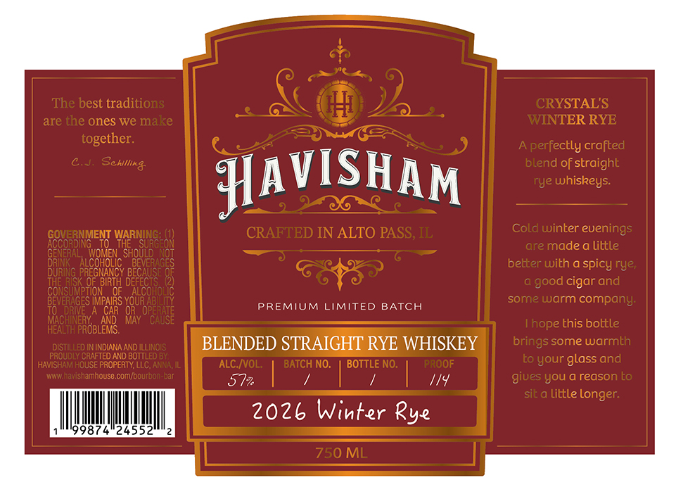

# TTB COLA Label Images - TTBID 26310001000427

**Brand Name:** HAVISHAM

**Fanciful Name:** WINTER RYE

**Issue Date:** 11/18/2026

**Origin Code:** 04

**Product Class/Type:** 122

**Source:** [TTB Public COLA Registry](https://ttbonline.gov/colasonline/viewColaDetails.do?action=publicFormDisplay&ttbid=26310001000427)

## Label Images

### Label 1

## Extracted Label Text

*Text extracted via OCR - may contain errors*

### Label 1

The best traditions
CRYSTAL'S
are the ones
we
make
WINTER RYE
together:
A perfectly crafted
C.J.
blend of straight
HAVISHAM
rye whiskeys:
CRAFTED IN ALTO PASS, IL
Cold winter euenings
BEM87
Varuue
SURGE
are made a little
LEB
better with a spicy rye;
BIRTH DEFEC
good cigar and
YOUC
some Warm
company:
E
QAy
OPERI
peruse
PREMIUM LIMITED BATCH
'PROBLE
Thope this bottle
DISTILLED IN INDIANA AND ILLINOIS
BLENDED STRAIGHT RYE WHISKEY
brings some warmth
PROUDLY CRAFTEO AND BOTTLED BY
to your glass and
HAVISHAM KOUSE PROPERTY LLC; ANNA;
ALC IVOL;
BATCH NO:
BOTTLE NO:
PROOF
wnnnavishamnouse combouroon-dar
572
114
giues you @ reason to
sit a little longer:
2026 Winter Rye
9987
2455
750 ML
Schllina
