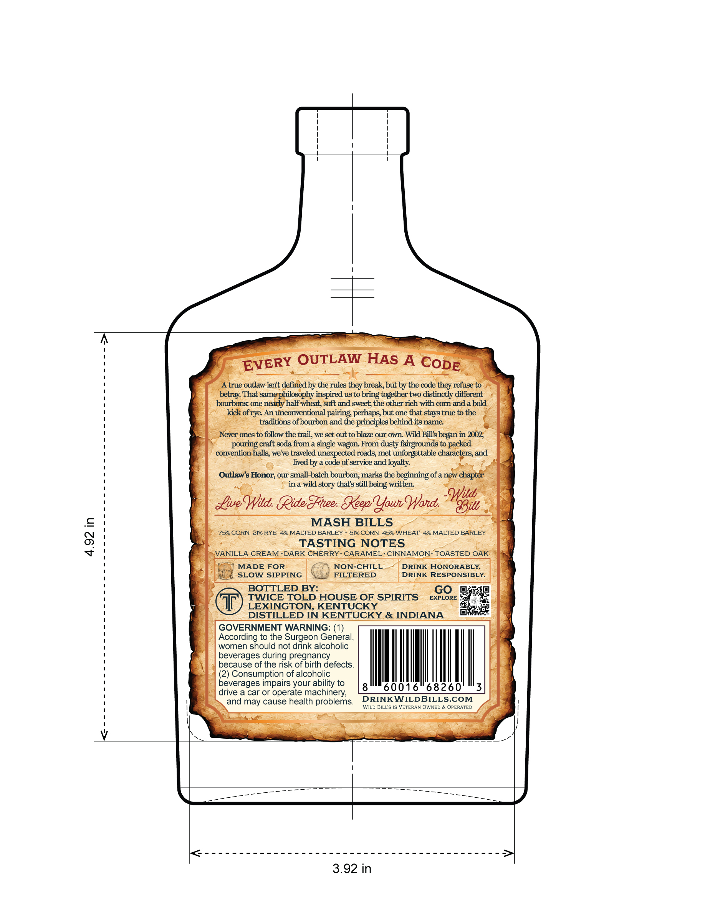
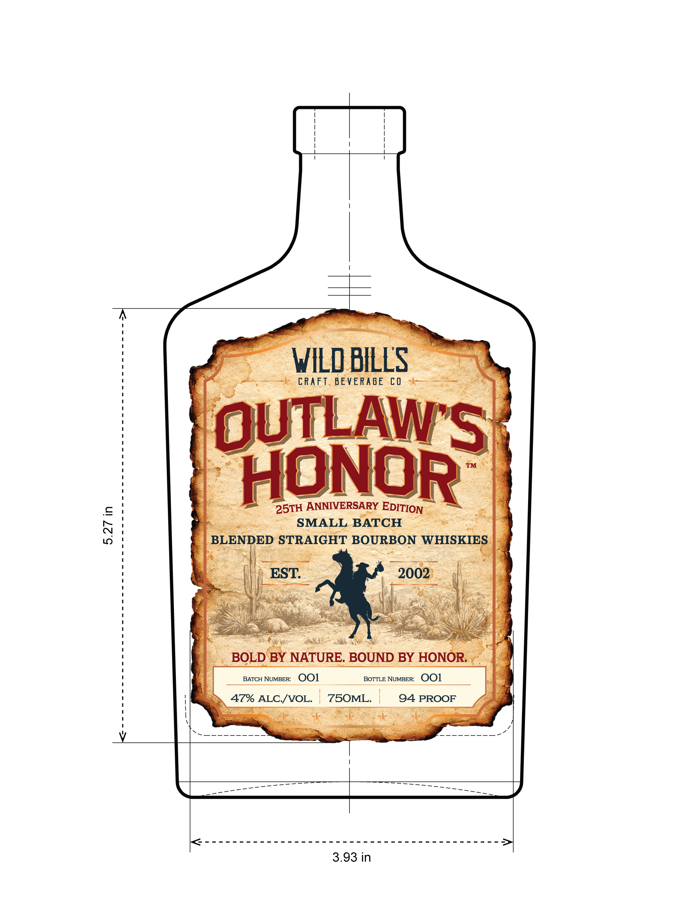

# TTB COLA Label Images - TTBID 26310001000448

**Brand Name:** OUTLAW'S HONOR

**Issue Date:** 11/12/2026

**Origin Code:** 22

**Product Class/Type:** 121

**Source:** [TTB Public COLA Registry](https://ttbonline.gov/colasonline/viewColaDetails.do?action=publicFormDisplay&ttbid=26310001000448)

## Label Images

### Back Label

### Front Label

## Extracted Label Text

*Text extracted via OCR - may contain errors*

**Detected Proof:** 94

### Back Label

EVERY OUTLAW HAS A
Atrue outlaw isnt defined by the rules they break; but by the code
refuse to
betray: That same philosophy inspired us to bring together two distinctly different
bourbons: one ncarly half wheat; soft and sweet; the other rich with corn and a bold
kick
An unconventional pairing perhaps but one that stays true to the
traditions ofbourbon and the principles behind its name
Never ones to follow the trail, we set out to blaze our own. Wild Bills
in 2002,
pouring craft soda
single wagon From dusty fairgrounds to packed
convention halls wetve traveled unexpected roads met unforgettable characters; and
lived by a code of service and loyalty:
Outlaw's Honor; our small-batch bourbon, marks the beginning ofa new chapter
in a wild
thats still being written:
~ueHWild RideBiee: Bepp !lounHond -?eal
MASH BILLS
75% CORN 21% RYE
4% MALTED BARLEY
51% CORN
45% WHEAT
4% MALTED BARLEY
{
TASTING NOTES
VANILLA CREAM
DARK CHERRY_
CARAMEL : CINNAMON
TOASTED OAK
MADE FOR
NON-CHILL
DRINK HONORABLY.
SLOW SIPPING
FILTERED
DRINK RESPONSIBLY.
BOTTLED BY:
GO
TWICE TOLD HOUSE OF SPRRITS
EXPLORE
LEXINGTON
KENTUCKY
DISTILLED IN KENTUCKY & INDIANA
GOVERNMENT WARNING: (1)
According to the Surgeon General,
women should not drink alcoholic
beverages during pregnancy
because of the risk of birth defects.
(2) Consumption of alcoholic
beverages impairs your ability to
8
60016
68260
3
drive a car or operate
machinery;
and may cause health problems
DRINKWILDBILLS.COM
WILD BILLS
S VETERAN OWNED & OPERATED
3.92 in
CODE
{they -
ofrye
began
from
story

### Front Label

VILD BILLS
CRAFT
BEVERAGE
CO
OUTLAWS
HONOR
25TH ANNIVERSARY
8
SMALL BATCH
BLENDED STRAIGHT BOURBON WHISKIES
EST:
2002
BOLD BY NATURE: BOUND BY HONOR
BATCH NUMBER:
OO1
BOTTLE NUMBER:
OO1
47% ALC IVOL:
75OML:
94 PROOF
3.93 in
EDITION
