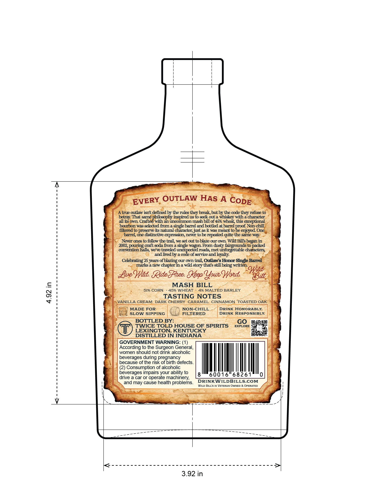
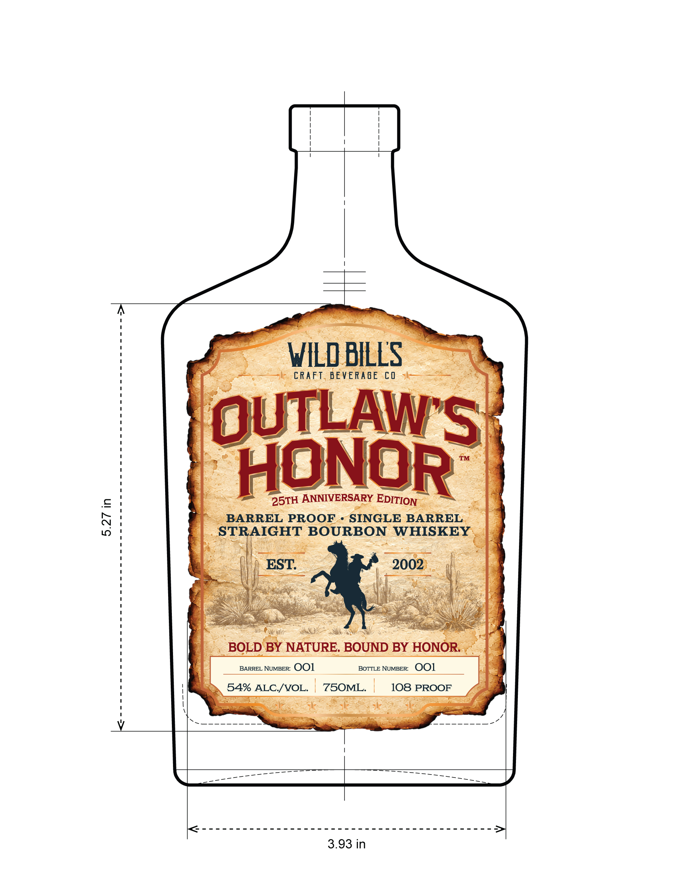

# TTB COLA Label Images - TTBID 26310001000455

**Brand Name:** OUTLAW'S HONOR

**Issue Date:** 11/12/2026

**Origin Code:** 22

**Product Class/Type:** 101

**Source:** [TTB Public COLA Registry](https://ttbonline.gov/colasonline/viewColaDetails.do?action=publicFormDisplay&ttbid=26310001000455)

## Label Images

### Back Label

### Front Label

## Extracted Label Text

*Text extracted via OCR - may contain errors*

**Detected Proof:** 108

### Back Label

OUTLAW HAS
A
Atrue outlaw ignt defined by the rules
break; but by the code
refuse to
betray That game philosophy ingpired u8
tbep]
seek out a
whiskey with a character
allits own Crafted with an uncommon mash bill of 45% wheat, this
exceptional
bourbon was selected from a single barrel and bottled at barrel proof Non-chill
filtered to preserve itg natural character; just as it was meant to be enjoyed One
barzel one distinctive expression, never to be repeated quite the game Way:
Never ones to follow the trail we set
toblaze our own Wild Bilg began in
2002, pouring craft eoda from a gingle wagon From dugty fairgrounds to packed
convention hallg; wetve traveled
roadg met
unforgettable characterg
livedby
uodeof &
of service and loyalty:
Celebrating 25,years ofblazing our own trail Outlaws Honor Single Barrel
marks a new chapter in a wild
thatg gtilbeing written
Ziue'Wild RideGhee: &eeplou Wand
93u
MASH BILL
51% CORN
45% WHEAT
4% MALTED BARLEY
8
TASTING NOTES
VANILLA CREAM
DARK CHERRY
CARAMEL
CINNAMON
TOASTED OAK
MADE FOR
NON-CHILL
DRINK HONORABLY
SLOW SIPPING
FILTERED
DRINK RESPONSIBLY
BOTTLED BY:
GO
TWICE TOLD HOUSE OF SPIRITS
EXPLORE
LEXINGTON KENTUCKY
DISTILLED IN INDIANA
GOVERNMENT WARNING: (1)
According to the Surgeon General,
women should not drink alcoholic
beverages
pregnancy
because of the risk of birth defects_
(2) Consumption of alcoholic
beverages impairs your ability to
8
60016
68261
drive a car or operate machinery;
and may cause health problems_
DRINKWILDBILLS.COM
WILD BLLS IS VETERAN OWNED & OPERATED
3.92 in
CODE
EVERY
they
out -
and
story -
during

### Front Label

VILD BILLS
CRAFT
BEVERAGE
CO
OUTLAWS
HONOR
25TH ANNIVERSARY
8
BARREL PROOF
SINGLE BARREL
STRAIGHT BOURBON
WHISKEY
EST:
2002
BOLD BY NATURE: BOUND BY HONOR
BARREL NUMBER:
OO1
BOTTLE NUMBER:
OO1
54% ALC /VOL:
75OML:
108 PROOF
3.93 in
EDITION
