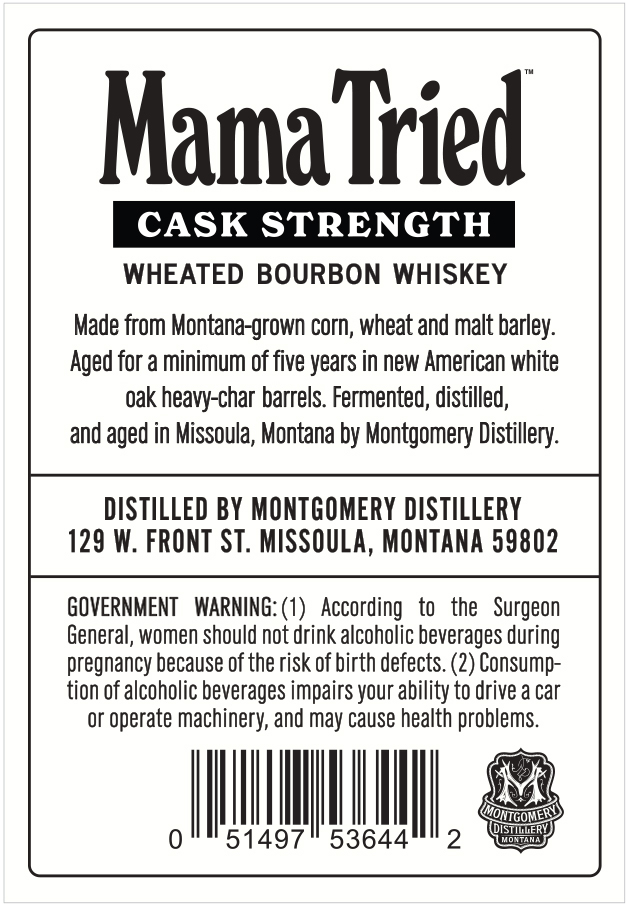
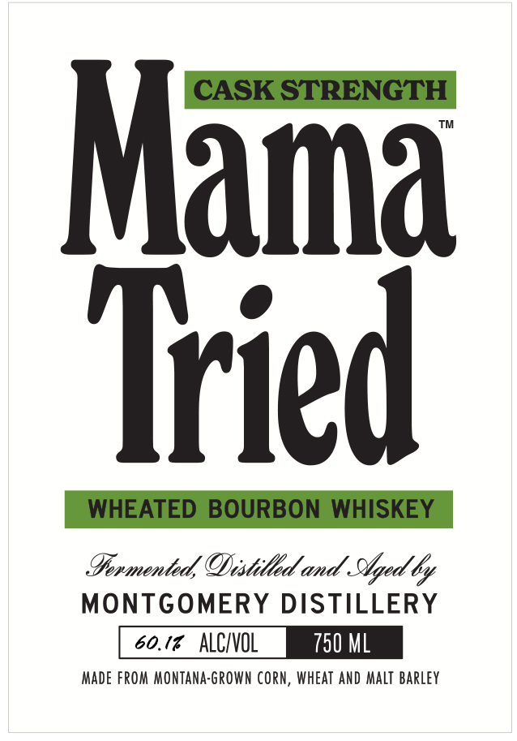

# TTB COLA Label Images - TTBID 26310001000477

**Brand Name:** MAMA TRIED

**Fanciful Name:** CASK STRENGTH

**Issue Date:** 11/12/2026

**Origin Code:** 30

**Product Class/Type:** 141

**Source:** [TTB Public COLA Registry](https://ttbonline.gov/colasonline/viewColaDetails.do?action=publicFormDisplay&ttbid=26310001000477)

## Label Images

### Back Label

### Front Label

## Extracted Label Text

*Text extracted via OCR - may contain errors*

### Back Label

MamaTried
CASK STRENGTH
WHEATED BOURBON WHISKEY
Made from Montana-grown corn; wheat and malt barley:
Aged for a minimum of five years in new American white
oak heavy-char barrels: Fermented, distilled,
and
in Missoula, Montana by Montgomery Distillery:
DISTILLED BY MONTGOMERY DISTILLERY
129 W: FRONT ST . MISSOULA , MONTANA 59802
GOVERNMENT   WARNING: (1)   According   to
the   Surgeon
General, women should not drink alcoholic beverages during
pregnancy because of the risk of birth defects: (2) Consump-
tion Of alcoholic beverages impairs your ability to drive a car
Or
operate machinery; and may cause health problems
ONIGOMER
JISTIMGERI
51497
53644
2
Fnortaan
aged

### Front Label

CASK STRENGTH
Mama
Tried
WHEATED BOURBON WHISKEY
Inmented, ODistilld and Otged 6
MONTGOMERY DISTILLERY
60.17
ALCIVOL
750 ML
Made FROM MOnTAna-Grown corn, WHEAT AND Malt Barley
