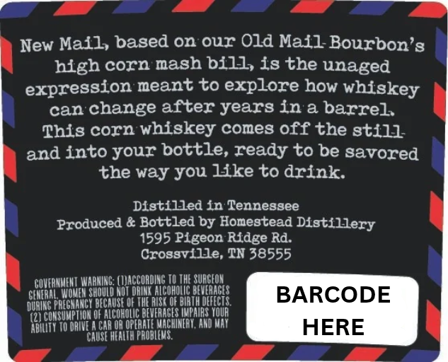
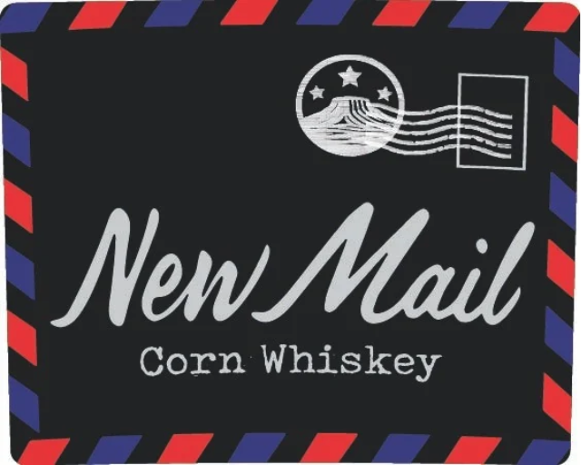

# TTB COLA Label Images - TTBID 26310001000481

**Brand Name:** NEW MAIL

**Issue Date:** 11/10/2026

**Origin Code:** 43

**Product Class/Type:** 143

**Source:** [TTB Public COLA Registry](https://ttbonline.gov/colasonline/viewColaDetails.do?action=publicFormDisplay&ttbid=26310001000481)

## Label Images

### Back Label

### Front Label

## Extracted Label Text

*Text extracted via OCR - may contain errors*

*1 image(s) excluded: text did not meet readability threshold*

### Back Label

New Mail, based
our Old Mail Bourbon'&
high corn mash bill, is the unaged
expression meant to explore how whiskey
can change after years In a barrel
This corn whiskey comeg off the gt1l1
and into your bottle, ready to be savored
the way you like to drink:
Distilled in Tenneggee
Produced & Bottled by Honestead Distillery
1595 Pigeon Ridge Rd:
Crosgvflle, TN 38555
GOVERVMEHI WAHMING: (Waccording IDTHE SUBCEON
GFMERAL WOMEM SHouLd MoT DALTT OLCOHOLG HEVEAAGES
BARCODE
DuRHG PREGIANCI DFCAuSIQE the nt QF BURTHMETEOTS
CukSuMpi_oN OF AICOHOLG DIVERACLS UMPMAS YOuR
RHGH
TO DRWZ A CAn @n OPIAATE MACHINIRT, And MAT
HERE
Causi HEALth PrObLEVS:
on
