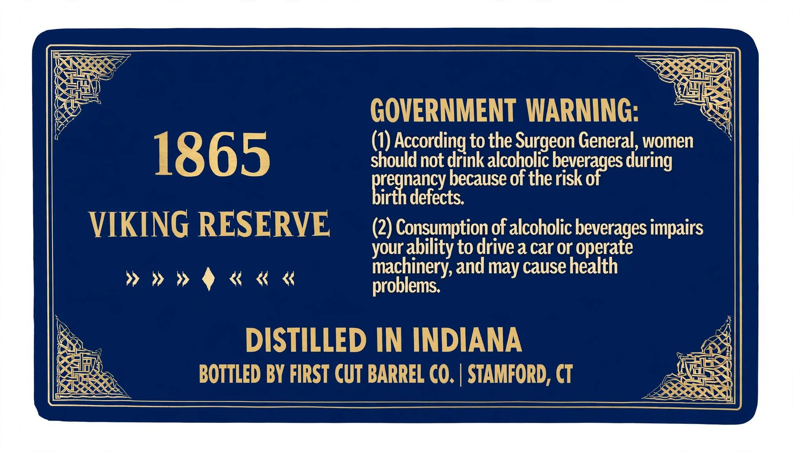
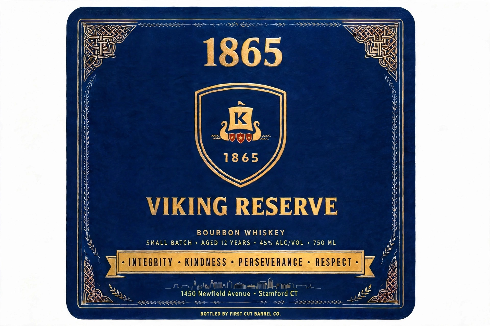

# TTB COLA Label Images - TTBID 26310001000563

**Brand Name:** 1865 VIKING RESERVE

**Issue Date:** 11/12/2026

**Origin Code:** 14

**Product Class/Type:** 141

**Source:** [TTB Public COLA Registry](https://ttbonline.gov/colasonline/viewColaDetails.do?action=publicFormDisplay&ttbid=26310001000563)

## Label Images

### Back Label

### Front Label

## Extracted Label Text

*Text extracted via OCR - may contain errors*

**Detected Proof:** 90
**Detected Age:** 12 Years

### Back Label

GOVERNMENT WARNING:
(1) According to the Surgeon General; women
1865
should not drink alcoholic beverages during
because of the risk of
Dredraetevbec
VIKING RESERVE
(2) Consumption of alcoholic beverages impairs
your =
todrive acar or operate
machinery; and may cause health
problems
DISTILLED IN INDIANA
BOTTLED BY FIRST CUT BARREL (O. | STAMFORD, CT
ability

### Front Label

6eee6666662
263 -83333926cs > ?37
45373,97773
1865
Lk
18 65
VIKING RESERVE
B0 URBON
WHISKEY
SMALL BATCH
AGED 12 YEARS
45 % ALC/voL
750 ML
INTEGRITY
KINDNESS
PERSEVERANCE
RESPECT
~"Mn6
1450 Newfield Avenue
Stamford CT
866 4k846662
BOTTLED BY FIRST CUt BARREL CO.
ali/
