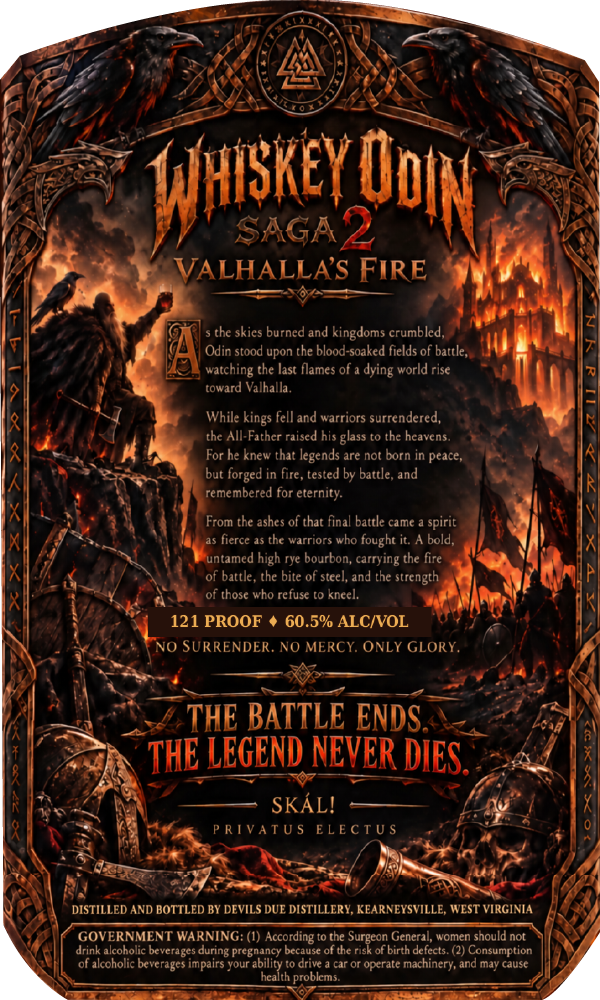
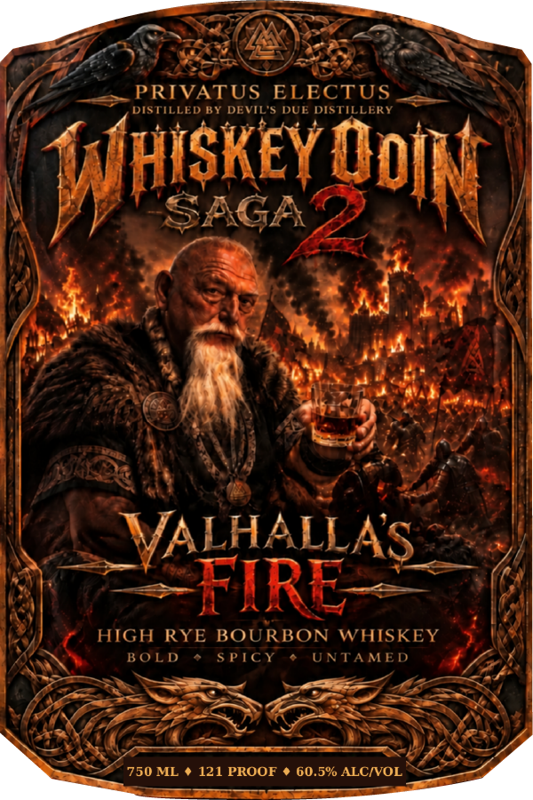

# TTB COLA Label Images - TTBID 26310001000567

**Brand Name:** DEVIL'S DUE DISTILLERY

**Fanciful Name:** VALHALLA'S FIRE HIGH RYE BOURBON WHISKEY

**Issue Date:** 11/12/2026

**Origin Code:** 47

**Product Class/Type:** 141

**Source:** [TTB Public COLA Registry](https://ttbonline.gov/colasonline/viewColaDetails.do?action=publicFormDisplay&ttbid=26310001000567)

## Label Images

### Back Label

### Label 1

## Extracted Label Text

*Text extracted via OCR - may contain errors*

**Detected Proof:** 121

### Back Label

Wwiskev_
SAGA2
VALHALLAS FIRE
the skies burned and kingdoms crumbled;
Odin stood upon the blood-soaked fields of battle;
the last flames of
world rise
toward Valhalla
While kings fell,
warriors surrendered;
the All-Father raised his glass to the hcavens.
For he knew that legends are not born in peace,
but forged in fire , tested by battle, and
remembered for eternity:
From the
of that final battle came
spirit
fierce
the warriors who fought it
bold
untamed high rye bourbon; carrying the fire
of battle
the bite of stcel, and the strength
those who refuse [0 kricel:
121 PROOF
60.5% ALCIVOL
VO SURRENDER. NO MERCY ONLY GLORY
THE BATTLE ENDS
LEGEND NEVER DIES `
SKALI
P R IVATU 5
E LE CTU $
DISTILLED AND BOTTLED BY DEVILS DUE DISTILLERY EEARNEYSVILLE; WEST VIRGINIA
GOVERNMENT WARNING: (1) According
Surgeon General, women should not
drink alcokolic bevcrages
pregnancy because of the risk of birth defects. (2) Consumption
of alccholic beverages impairs your ability t0 drive
Crom
opcrate machinery; and may cause
hcalth problcms.
(Odn"
watching
dving
and
shes
THE
during

### Label 1

PRIVATUS
ELECTUS
DISTILLED BY
DEVILS
DUE DISTILLERY
WHtskev Qofnt
SAGA
VALHALLAS
FIRE
HIGH
RYE BOURBON
WHISKEY
BOLD
S PICY
UNTAMED
750 ML
121 PROOF
60.5% ALCIVOL
