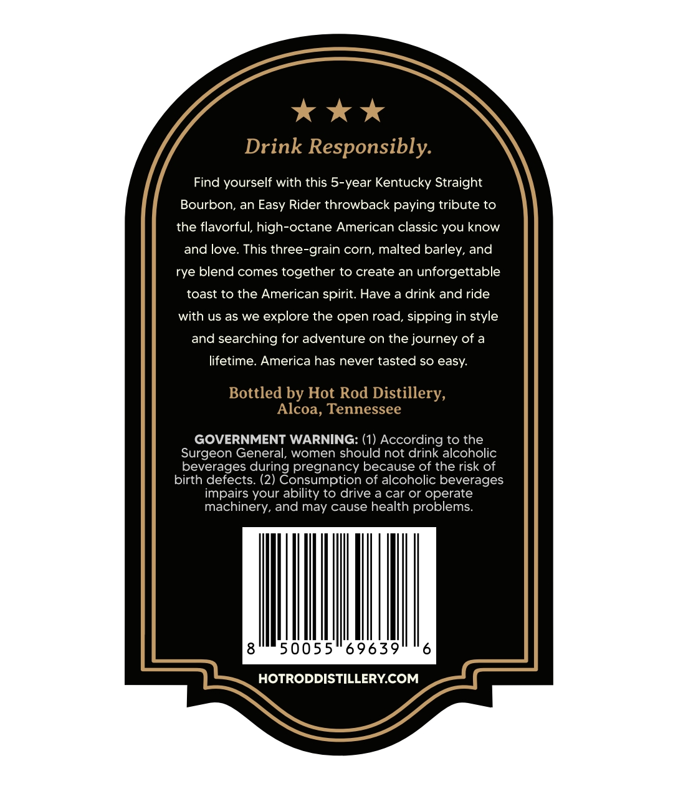
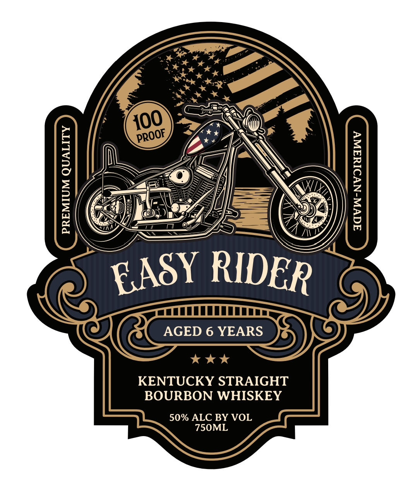

# TTB COLA Label Images - TTBID 26310001000631

**Brand Name:** EASY RIDER

**Fanciful Name:** KENTUCKY STRAIGHT BOURBON WHISKEY

**Issue Date:** 11/12/2026

**Origin Code:** 43

**Product Class/Type:** 101

**Source:** [TTB Public COLA Registry](https://ttbonline.gov/colasonline/viewColaDetails.do?action=publicFormDisplay&ttbid=26310001000631)

## Label Images

### Back Label

### Front Label

## Extracted Label Text

*Text extracted via OCR - may contain errors*

**Detected Proof:** 100
**Detected Age:** 6 Years

### Back Label

Drink Responsibly.
Find yourself with this 5-year Kentucky Straight
Bourbon, an Easy Rider throwback paying tribute to
the flavorful, high-octane American classic you know
and love. This three-grain corn, malted barley, and
rye blend comes together to create an unforgettable
toast to the American spirit: Have a drink and ride
with us as we explore the open road, sipping in style
and searching for adventure on the journey of a
lifetime
America has never tasted sO easy:
Bottled by Hot Rod Distillery,
Alcoa, Tennessee
GOVERNMENT WARNING: (1) According to the
Surgeon General;, women should not drink alcoholic
beverages during pregnancy because of the risk of
birth defects. (2) Consumption of alcoholic beverages
impairs your ability to drive a car or operate
machinery, and may cause health problems_
50055
69639
6
HOTRODDISTILLERYCOM

### Front Label

0
1
[
{
AGED 6 YEARS
KENTUCKY STRAIGHT
BOURBON WHISKEY
50% ALC BY VOL
750ML
100
PROOF_
RIDER
EASY
