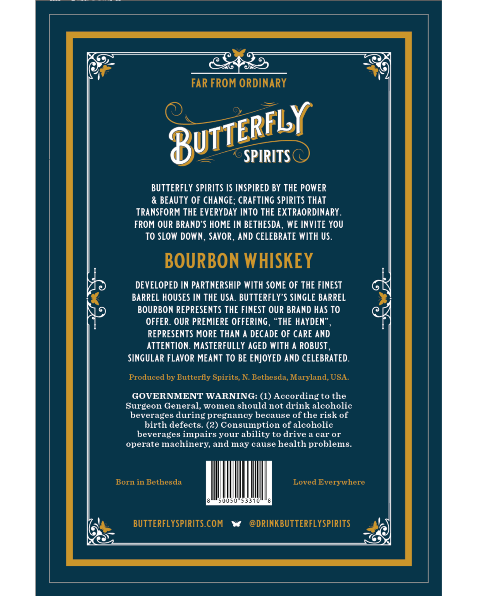
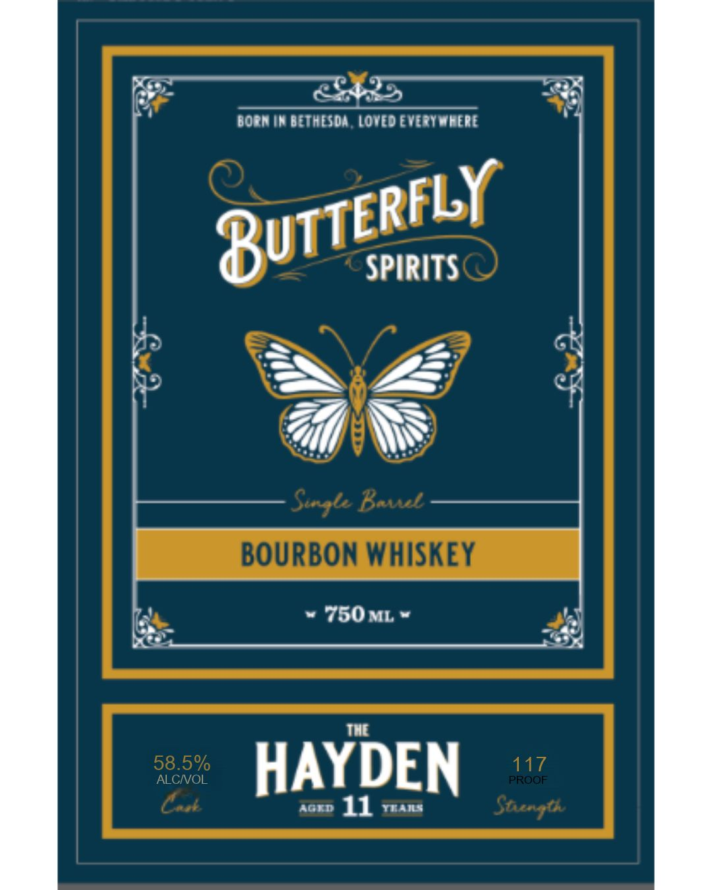

# TTB COLA Label Images - TTBID 26311001000074

**Brand Name:** BUTTERFLY SPIRITS

**Issue Date:** 11/12/2026

**Origin Code:** 25

**Product Class/Type:** 141

**Source:** [TTB Public COLA Registry](https://ttbonline.gov/colasonline/viewColaDetails.do?action=publicFormDisplay&ttbid=26311001000074)

## Label Images

### Back Label

### Label 1

## Extracted Label Text

*Text extracted via OCR - may contain errors*

**Detected Proof:** 117

### Back Label

FAR FROM ORDINARY
SPIRITS €
BUTTERFLY SPIRITS IS INSPIRED BY THE POWER
& BEAUTY OF CHANGE; CRAFTING SPIRITS THAT
TRANSFORM THE EVERYDAY INTO THE EXTRAORDINARY
FROM OUR BRAND'$ HOME IN BETHESDA , WE INVITE YOU
To SLOW DOWN , SAVOR , AND CELEBRATE WITH US.
BOURBON WHISKEY
DEVELOPED IN PARTNERSHIP WITH SOME OF THE FINEST
BARREL HOUSES IN THE USA . BUTTERFLY"S SINGLE BARREL
BOURBON REPRESENTS THE FINEST OUR BRAND HAS TO
OFFER OUR PREMIERE OFFERING , "THE HAYDEN"
REPRESENTS MORE THAN A DECADE OF CARE AND
ATTENTION
MASTERFULLY AGED WITH A ROBUST,
SINGULAR FLAVOR MEANT TO BE ENJOYED AND CELEBRATED.
Produced by Butterfly Spirits; N. Bethesda, Maryland,USA
GOVERNMENT WARNING: (1) According to the
Surgeon General; women should not drink alcoholic
beverages during pregnancy because of the risk of
birth defects: (2) Consumption of alcoholic
beverages impairs your ability to drive a car or
operate machinery; and may cause health problems
Born in Bethesda
Loved Everywhere
uus
BUTTERFLYSPIRITS COM
@DRINKBUTTERFLYSPIRITS
BUTTERFLY

### Label 1

boen IA Bethesda , LOvED Everyurere
Spiritse
Sugb Baul
BOURBON WHISKEY
750ML
TuE
58.5%
HAYDEN
117
ALCNOL
PROOF
AGtD
11 nans
Suuenzth
8UTTERFLY
