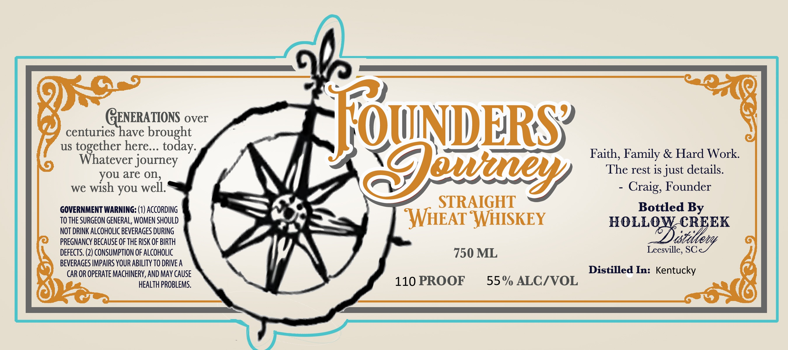

# TTB COLA Label Images - TTBID 26312001000010

**Brand Name:** FOUNDERS' JOURNEY STRAIGHT WHEAT WHISKEY

**Issue Date:** 11/12/2026

**Origin Code:** 41

**Product Class/Type:** 109

**Source:** [TTB Public COLA Registry](https://ttbonline.gov/colasonline/viewColaDetails.do?action=publicFormDisplay&ttbid=26312001000010)

## Label Images

### Label 1

## Extracted Label Text

*Text extracted via OCR - may contain errors*

**Detected Proof:** 110

### Label 1

QK9
GENERATIONS
over
centuries have brought
us
togethev ercjoumod
Exgwus
Faith, Family & Hard Work
you are on,
ewueyy
The rest is just details.
we wish you well:
Craig; Founder
GOVERNMENT WARNING: (1) ACCORDING
STRAIGHT
Bottled
TO THE SURGEON GENERAL, WOMEN SHOULD
WHEAT WHISKEY
HOLLOW CREEK
NOT DRINK ALCOHOLIC Beverages DURING
PREGNANCY BECAUSE OF THE RISK OF BIRTH
stddtesy
DEFECTS, (2) CONSUMPTION OF ALCOHOLIC
750 ML
Leesville, SC_
BEVERAGES IMPAIRS YOUR ABILITY TO DRIVE A
CAR OR OpeRATe MACHINERY, AND May CAUSE
Distilled In: Kentucky
HEALTH PROBLEMS .
110 PROOF
55% ALC/VOL
today:
By
