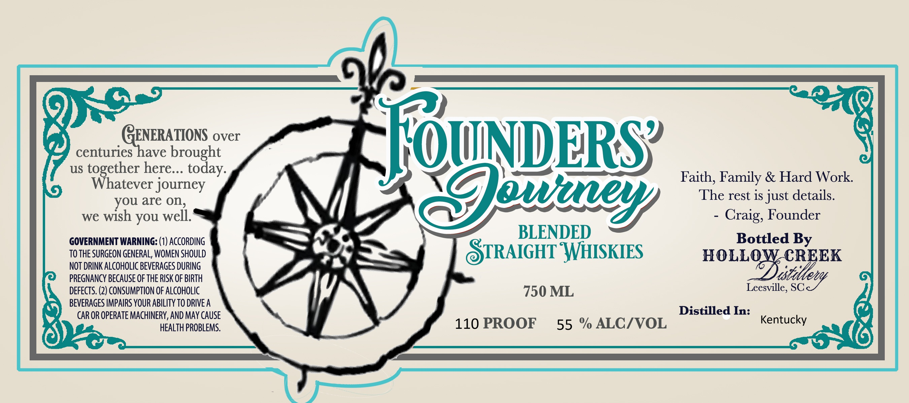

# TTB COLA Label Images - TTBID 26312001000011

**Brand Name:** FOUNDERS' JOURNEY BLENDED STRAIGHT WHISKIES

**Issue Date:** 11/12/2026

**Origin Code:** 41

**Product Class/Type:** 120

**Source:** [TTB Public COLA Registry](https://ttbonline.gov/colasonline/viewColaDetails.do?action=publicFormDisplay&ttbid=26312001000011)

## Label Images

### Back Label

## Extracted Label Text

*Text extracted via OCR - may contain errors*

**Detected Proof:** 110

### Back Label

GENERATIONS over
centuries have brought
us
togethev ercjoumod
Egwus
Faith; Family & Hard Work
you are on,
The rest is just details.
we wish you well:
Craig; Founder
GOVERNMENT WARNING: (1) ACCORDING
BLENDED
Bottled
TO THE SURGEON GENERAL, WOMEN SHOULD
GTRAIGHT WHISKIES
HOLLOW CREEK
NOT DRINK ALcOHOLIC Beverages DURING
PREGNANCY BECAUSE OF THE RISK OF BIRTH
sttdtteiy
DEFECTS, (2) CONSUMPTION OF ALCOHOLIC
750 ML
Leesville, SC_
BEVERAGES IMPAIRS YOUR ABILITY TO DRIVE A
CAR OR OpeRATe MACHINERY, AND May CAUSE
Distilled In:
HEALTH PROBLEMS .
110 PROOF
55 % ALC/VOL
Kentucky
today:
By
