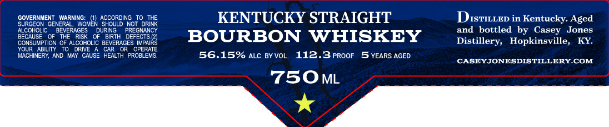
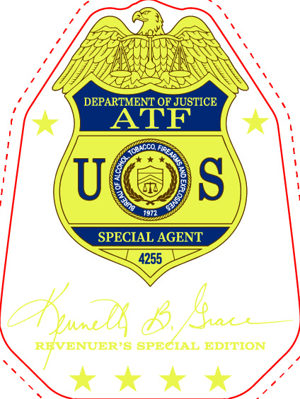

# TTB COLA Label Images - TTBID 26312001000086

**Brand Name:** REVENUER'S SPECIAL EDITION

**Issue Date:** 11/13/2026

**Origin Code:** 22

**Product Class/Type:** 101

**Source:** [TTB Public COLA Registry](https://ttbonline.gov/colasonline/viewColaDetails.do?action=publicFormDisplay&ttbid=26312001000086)

## Label Images

### Label 1

### Label 2

## Extracted Label Text

*Text extracted via OCR - may contain errors*

**Detected Proof:** 112.3
**Detected Age:** 5 Years

### Label 1

GOVERNMENT
WARNING:
ACCORDING
IHE
KENTUCKY STRAIGHT
DISTILLED in Kentucky: Aged
SURGEON
GENERAL,
WONEN SHCULD NOT DRINK
ALCOHOLIC
BEVERAGES
DURING
PREGNANCY
and bottled by
Casey
Jones
BECAUSE
RiSk
RTH
DEFECTS
BOURBON
WHISKEY
CCNSUMPTION OF ALCOHOLIC BEVERAGES IMPAIRS
Distillery,
Hopkinsville,
KY
YOUR   ABILITY
DRIVE
CAR
OPERATE
MACHINERY, AND May CAUSE HEALTH
PROBLEMS.
56.15% ALC BY VOL.  112.3PROOF
5 YEARS AGED
CASEYJONESDISTILLERY COM
750ML

### Label 2

DEPARTMENT OF JUSTICE
ATF
U
1972
SPECIAL AGENT
4255
KunzO4 8,S
VENUER
SPECIAL EDITION
{oencco_
FIRERU
