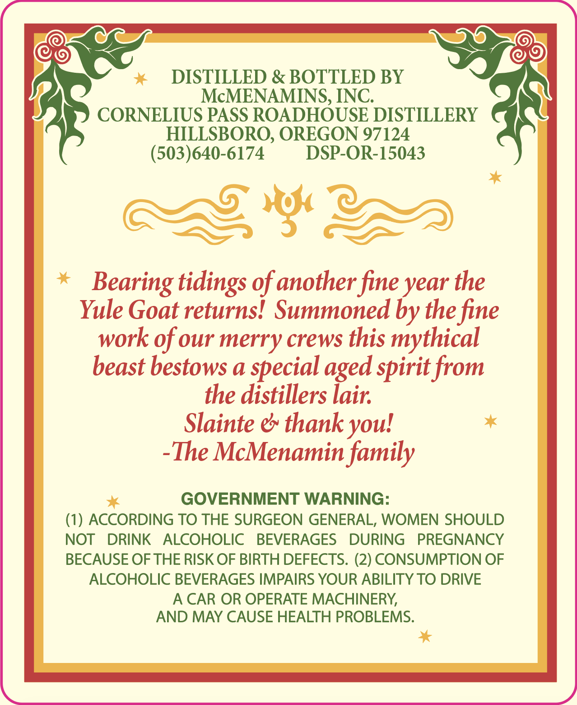
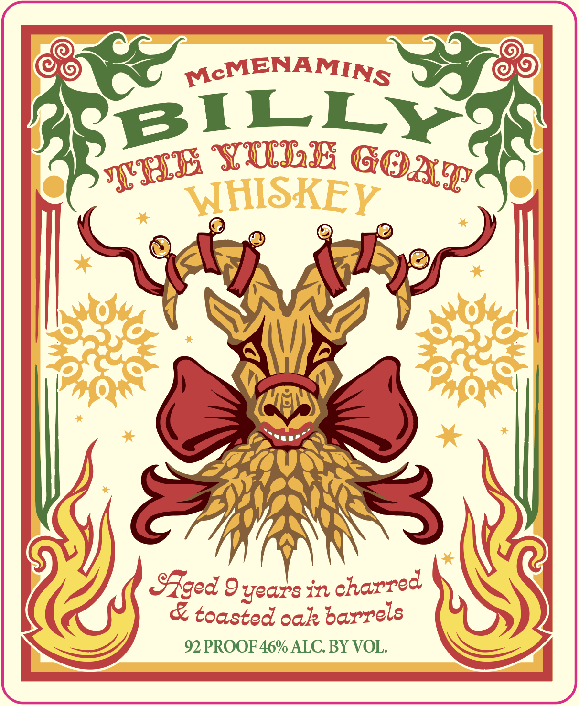

# TTB COLA Label Images - TTBID 26312001000089

**Brand Name:** MCMENAMINS

**Fanciful Name:** BILLY THE YULE GOAT

**Issue Date:** 11/13/2026

**Origin Code:** 38

**Product Class/Type:** 140

**Source:** [TTB Public COLA Registry](https://ttbonline.gov/colasonline/viewColaDetails.do?action=publicFormDisplay&ttbid=26312001000089)

## Label Images

### Back Label

### Front Label

## Extracted Label Text

*Text extracted via OCR - may contain errors*

**Detected Proof:** 92
**Detected Age:** 9 Years

### Back Label

DISTILLED & BOTTLED BY
McMENAMINS, INC:
CORNELIUS PASS ROADHOUSE DISTILLERY
HILLSBORO; OREGON 97124
(503)640-6174
DSP-OR-15043
Ngk
Bearing tidings of another fine
the
Yule Goat returns_ Summoned by the fine
work ofour merry crews this mythical
beast bestows a special aged spirit from
the distillers lair:
Slainte & thank youl
~The McMenamin family
GOVERNMENT WARNING:
(1) ACCORDING TO THE SURGEON GENERAL, WOMEN SHOULD
NOT
DRINK
ALCOHOLIC
BEVERAGES
DURING
PREGNANCY
BECAUSE OF THE RISK OF BIRTH DEFECTS. (2) CONSUMPTION OF
ALCOHOLIC BEVERAGES IMPAIRS YOUR ABILITY TO DRIVE
A CAR OR OPERATE MACHINERY;
AND MAY CAUSE HEALTH PROBLEMS:
year

### Front Label

McMENAMINS
5
SBILLY
KIILJJ
VHISKEY
3
SZged 9 years in
& toasted oak barrels
92 PROOF 46% ALC. BY VOL
JCHLH
Oa9e
charred
