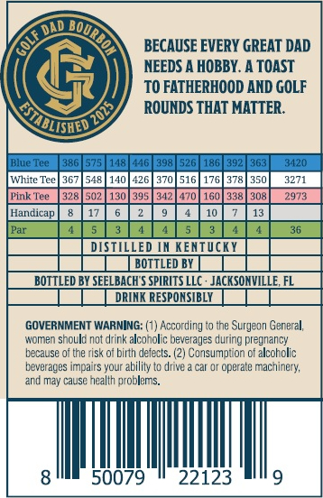
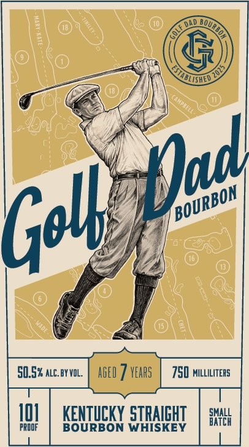

# TTB COLA Label Images - TTBID 26313001000027

**Brand Name:** GOLF DAD

**Issue Date:** 11/13/2026

**Origin Code:** 16

**Product Class/Type:** 101

**Source:** [TTB Public COLA Registry](https://ttbonline.gov/colasonline/viewColaDetails.do?action=publicFormDisplay&ttbid=26313001000027)

## Label Images

### Back Label

### Front Label

## Extracted Label Text

*Text extracted via OCR - may contain errors*

### Back Label

Dav
BECAUSE EVERY GREAT DAD
NEEDS
HOBBY. A TOAST
TO FATHERHOOD AND GOLF
ROUNDS THAT MATTER:
QBLISHED
Blue Tee
3861575
148/446
526
392
3420
Whitc Tce| 367
548
140/426|3701516/176|378
350
3271
Pink Tee
328/502
130/395
342|470/ 160| 338 / 308
2973
Handicap
Par
DKSIILLED I KENIUCKY
BOTTLED BY
BOTTLED BY SEEL BACH
SPIRLTS LLG . JACKSONVILLE FL
DRINK RESPONSIBLY
GOVERNMENT WARNING:
Accordin]
the Surgeon Gereral;
women shoula not drirk alconolic beverajes during pregnancy
because
the jisk e
birth defects: (2} Consumoion
alcoholic
Leverages impairs your abilily to drive
car dI operate Mac InCTN,
ard May causc ricalth problems
50079
22123
Gourdoa
GOLFE
2025

### Front Label

50,5% alC_by VOL;
AGEd
YEARS
750 Milliliters
Lo]
KENTUCKY SiRaIgHI
Hh#
pROOF
BOURBON WHISKEY
Iadi
IGell
BOURBON
