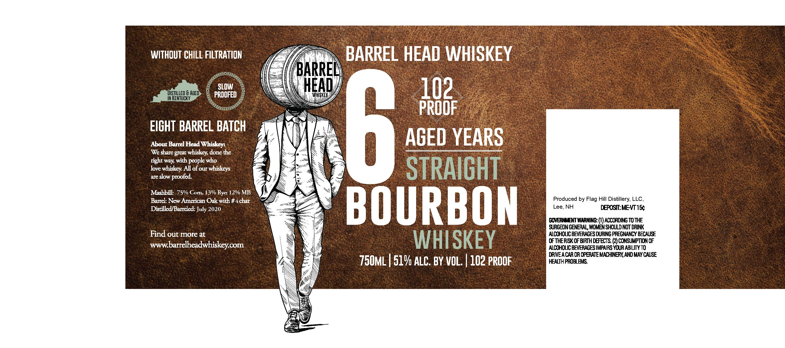

# TTB COLA Label Images - TTBID 26313001000031

**Brand Name:** BARREL HEAD WHISKEY

**Issue Date:** 11/12/2026

**Origin Code:** 33

**Product Class/Type:** 101

**Source:** [TTB Public COLA Registry](https://ttbonline.gov/colasonline/viewColaDetails.do?action=publicFormDisplay&ttbid=26313001000031)

## Label Images

### Label 1

## Extracted Label Text

*Text extracted via OCR - may contain errors*

**Detected Proof:** 102

### Label 1

WITHOUT CHILL FILTRATION
BARREL HEAD WHISKEY
BARREL
DISTILLED & AGED
PRUDFED
HEAD
WHISKET
102
IN KenTucky
PROOF
EICHT
About Barrel
BARREL
Head Whiskey:
BATCH
6
AGED YEARS
We share geat whiskey done the
right way with people who
love whiskey All of our whiskeys
STRAIGHT
ae slow
ptoofed
Mashbill: 75%
139 Rye; 12% MB
Barrel: New American Oak with #4char
Produced by Flag Hill Distillery, LLC
Distilled/Banreled: July 2020
BOURBON
Lee; NH
DPOSTT:MEWTIE
GOMTNEITWIRNING: (I) ACCCRDIN TOTHE
SURGEONGENERAL WOMENSHOULD NOT DRINK
Find out more at
ALCOHOUCBEVERAGES DURING FREGNANCY BECAUSE
WHISKEY
CFTHERISKOFBIRITH WEFECTS (2) CONSUMPTICN OF
WWW
barrelheadwhiskeycom
ALCOHOVCBEVERAGESIMPAIRS YOURABILIY TO
DRIVEACAR ORCPEATEMACHINERYAND MAY CAUSE
750ML | 51% ALC. BY VOL. | 102 PROOF
HEAITHPROBLEMS
Com,
