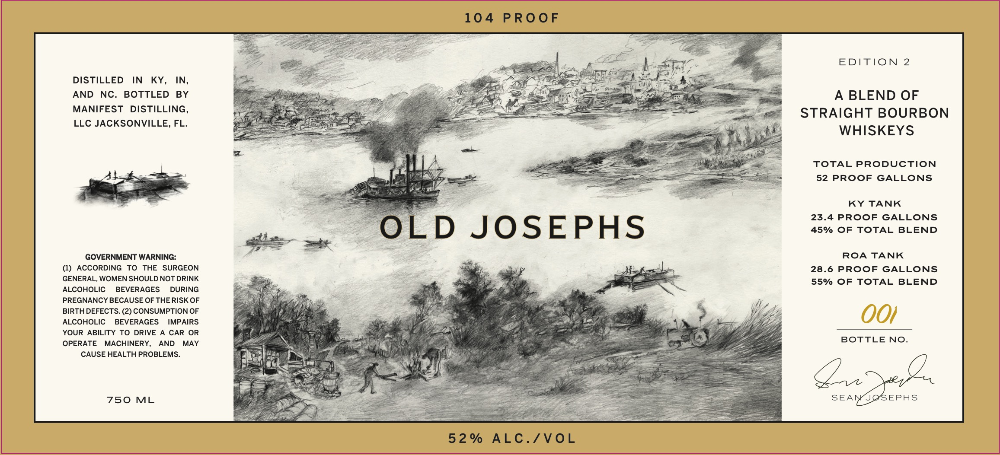

# TTB COLA Label Images - TTBID 26313001000040

**Brand Name:** OLD JOSEPH'S

**Fanciful Name:** EDITION 2

**Issue Date:** 11/13/2026

**Origin Code:** 16

**Product Class/Type:** 121

**Source:** [TTB Public COLA Registry](https://ttbonline.gov/colasonline/viewColaDetails.do?action=publicFormDisplay&ttbid=26313001000040)

## Label Images

### Front Label

### Label 2

## Extracted Label Text

*Text extracted via OCR - may contain errors*

*1 image(s) excluded: text did not meet readability threshold*

**Detected Proof:** 104

### Front Label

104 PROOF

ose

Se

i ae

wee =:

3

2

EDITION 2

Ee

beg

DISTILLED

IN KY,

IN,

as

AND NC. BOTTLED BY

pr,

vie

A BLEND OF

Pe

MANIFEST DISTILLING,

aa

STRAIGHT BOURBON

aie

a

ge

LLC JACKSONVILLE, FL.

WHISKEYS

TOTAL PRODUCTION

z!

52 PROOF GALLONS

jena

KY TANK

23.4 PROOF GALLONS

45% OF TOTAL BLEND

OLD JOSEPHS

GOVERNMENT WARNING:

ROA TANK

(1) ACCORDING TO THE SURGEON

28.6 PROOF GALLONS

GENERAL, WOMEN SHOULD NOT DRINK

55% OF TOTAL BLEND

ALCOHOLIC BEVERAGES DURING

PREGNANCY BECAUSE OF THE RISK OF

BIRTH DEFECTS. (2) CONSUMPTION OF

Tyo

Wz,

ja

ALCOHOLIC BEVERAGES

IMPAIRS

a,

Coa

YOUR ABILITY TO DRIVE A CAR OR

My Y

OPERATE MACHINERY, AND MAY

BOTTLE NO.

CAUSE HEALTH PROBLEMS.

Fi

nel ae

L

OE wet

aw

o—

\.

See

ays

A Tass

ie

ae

e

750 ML

SEA

EPHS

ge

Ms

ea

“lite

Tage

52% ALEC.7V OL
