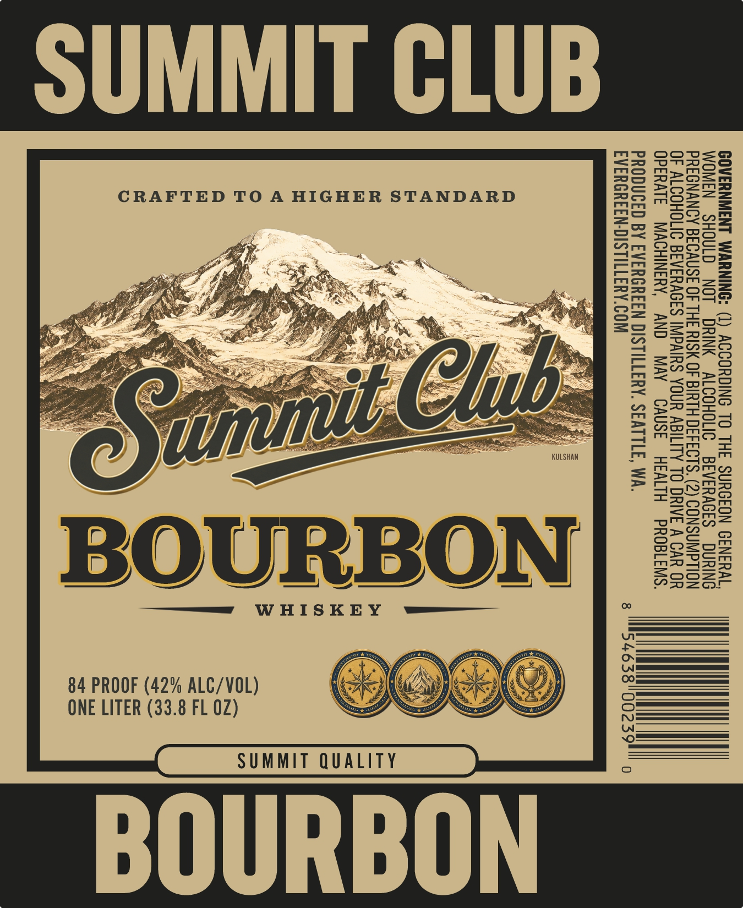

# TTB COLA Label Images - TTBID 26313001000162

**Brand Name:** SUMMIT CLUB

**Issue Date:** 11/12/2026

**Origin Code:** 07

**Product Class/Type:** 141

**Source:** [TTB Public COLA Registry](https://ttbonline.gov/colasonline/viewColaDetails.do?action=publicFormDisplay&ttbid=26313001000162)

## Label Images

### Front Label

## Extracted Label Text

*Text extracted via OCR - may contain errors*

### Front Label

GOVERNMENT WARNING: (1) ACCORDING TO THE SURGEON GENERAL,
WOMEN SHOULD NOT DRINK ALCOHOLIC BEVERAGES DURING
PREGNANCY BECAUSE OF THE RISK OF BIRTH DEFECTS. (2) CONSUMPTION
OF ALCOHOLIC BEVERAGES IMPAIRS YOUR ABILITY TO DRIVE A CAR OR
OPERATE MACHINERY, AND MAY CAUSE HEALTH PROBLEMS.

PRODUCED BY EVERGREEN DISTILLERY. SEATTLE, WA. 5h
EVERGREEN-DISTILLERY.COM C

KULSHAN

SUMMIT QUALITY

OU

=I
cs

=>
S
=>
=>nNw
=>o
o
— —
—_
Sa
ia)
Eo)
—~—
ire
ot
eo —!
of os
+=
-—)

CRAFTED TO A HIGHER STANDARD

@ )
