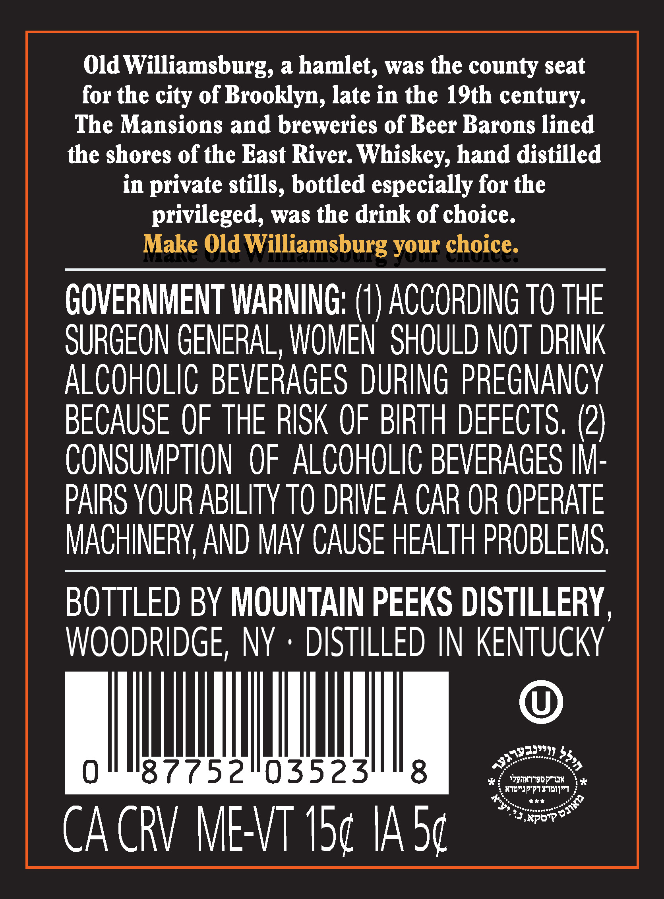
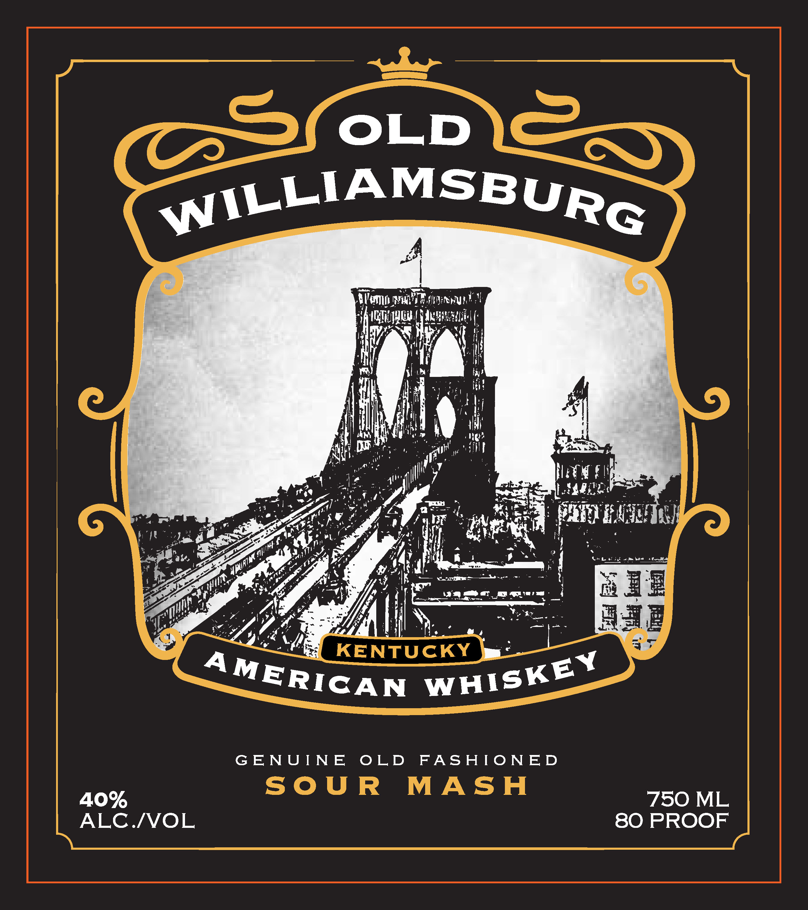

# TTB COLA Label Images - TTBID 26313001000196

**Brand Name:** OLD WILLIAMSBURG

**Issue Date:** 11/13/2026

**Origin Code:** 02

**Product Class/Type:** 140

**Source:** [TTB Public COLA Registry](https://ttbonline.gov/colasonline/viewColaDetails.do?action=publicFormDisplay&ttbid=26313001000196)

## Label Images

### Back Label

### Front Label

## Extracted Label Text

*Text extracted via OCR - may contain errors*

*1 image(s) excluded: text did not meet readability threshold*

### Back Label

for the city of Brooklyn, late in the 19th century.

Old Williamsburg, a hamlet, was the county seat

The Mansions and breweries of Beer Barons lined

the shores of the East River. Whiskey, hand distilled

in private stills, bottled especially for the

Make Old Williamsburg your choice.

privileged, was the drink of choice.

GOVERNMENT WARNING: (1) ACCORDING 10 THE

SURGEON GENERAL, WOMEN SHOULD NOT DRINK

ALCOHOLIC BEVERAGES DURING PREGNANCY

BECAUSE OF THE RISK OF BIRTH DEFECTS. (2)

CONSUMPTION OF ALCOHOLIC BEVERAGES IM

PAIRS YOUR ABILITY 10 DRIVE A CAR OR OPERATE

MACHINERY, AND MAY CAUSE HEALTH PROBLEMS

BOTTLED BY MOUNTAIN PEEKS DISTILLERY,

WOODRIDGE, NY + DISTILLED IN KENTUCKY

Om8 7 752°035235""8

Bene

TNT VO PAR

$6,

2

CACRV ME-VT To¢ IA 5¢
