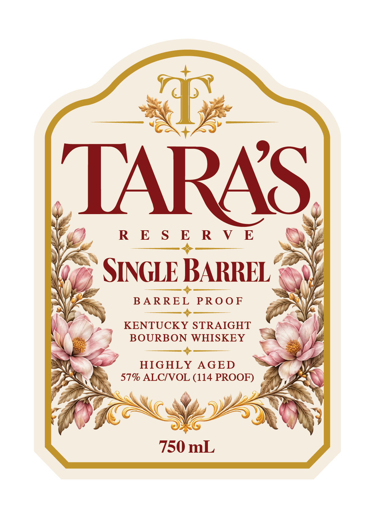
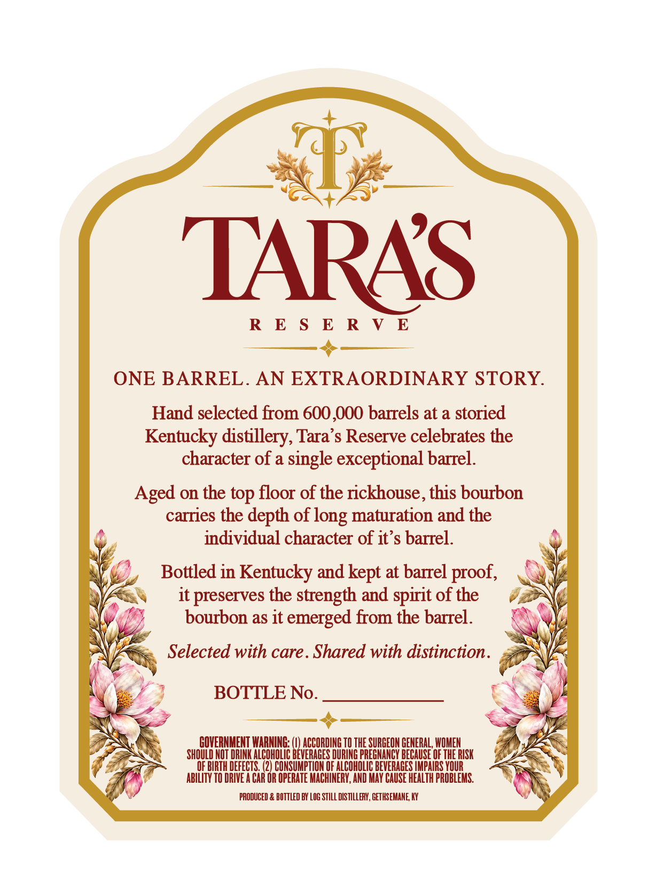

# TTB COLA Label Images - TTBID 26313001000275

**Brand Name:** TARA'S RESERVE

**Issue Date:** 11/16/2026

**Origin Code:** 22

**Product Class/Type:** 101

**Source:** [TTB Public COLA Registry](https://ttbonline.gov/colasonline/viewColaDetails.do?action=publicFormDisplay&ttbid=26313001000275)

## Label Images

### Label 1

### Label 2

## Extracted Label Text

*Text extracted via OCR - may contain errors*

**Detected Proof:** 114

### Label 1

TARAS
R E
S
E R V E
SINGLE BARREL
BARREL
PROO F
KENTUCKY STRAIGHT
BOURBON WHISKEY
HIGHLY
AGED
579 ALCIVOL (114 PROOF)
750 mL

### Label 2

TARAS
R E S E R V E
ONE BARREL _
AN EXTRAORDINARY STORY
Hand selected from 600,000 barrels at a storied
Kentucky distillery, Tara's Reserve celebrates the
character of a single
exceptional barrel.
Aged on the top floor of the rickhouse, this bourbon
carries the depth of long maturation and the
individual character of it's barrel.
Bottled in Kentucky and kept at barrel proof,
it preserves the strength and spirit of the
bourbon as it
emerged from the barrel .
Selected with care . Shared with distinction.
BOTTLE No.
HOVERNMENT WARMINe:
ACCORDING TO THE SURGEQN GENERAL, WOMEN
SHQULD NOI DRINK ALCQHOLIC BEVERAGES DURING PREGMANCY BECAUSE QF THE RISK
QF BIRIH DEFECTS, (2) CONSUMPTHON QE ALCOHOLIC BEVERAGES HMPHIRS VQUR
ABILITY TO DRIVE A CAR OR OPERATE MACHINERY, AND MaY CAUSE HEALTH PROBLEMS:
PRODUCED & BOTTLED BY LOG STILL DISTILLERY , GETHSEMANE KY
