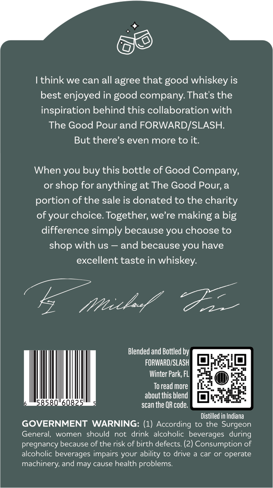
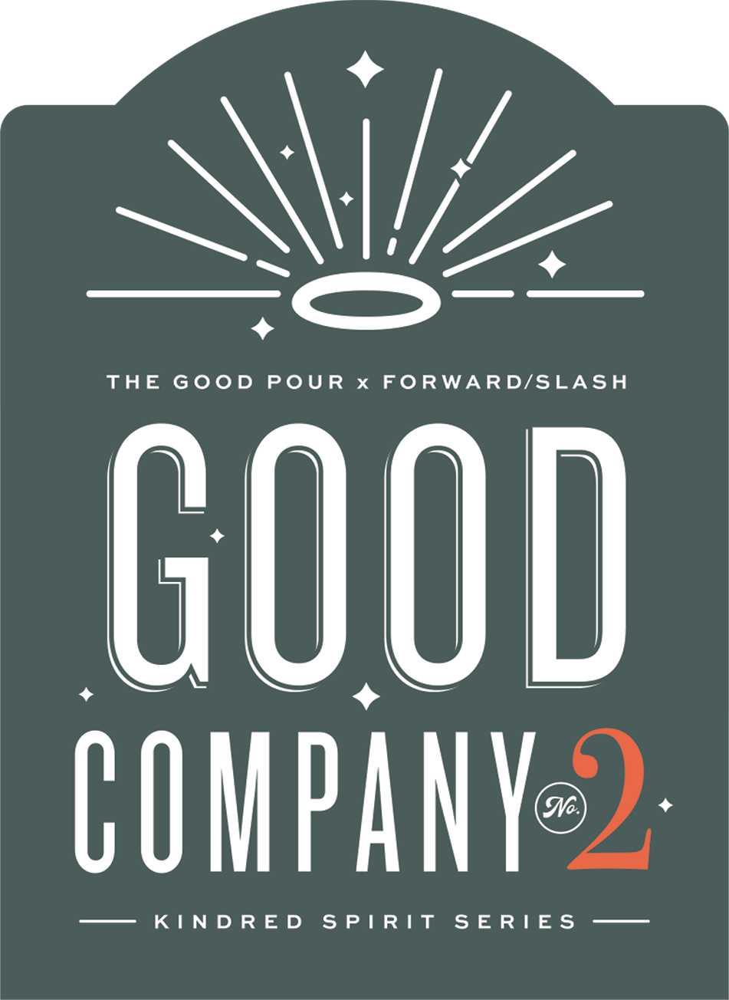
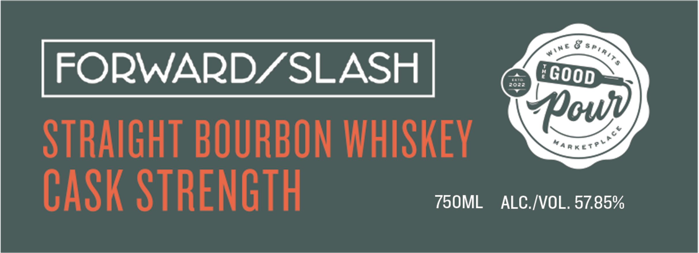

# TTB COLA Label Images - TTBID 26313001000295

**Brand Name:** GOOD COMPANY 2

**Issue Date:** 11/18/2026

**Origin Code:** 16

**Product Class/Type:** 101

**Source:** [TTB Public COLA Registry](https://ttbonline.gov/colasonline/viewColaDetails.do?action=publicFormDisplay&ttbid=26313001000295)

## Label Images

### Back Label

### Label 1

### Label 2

## Extracted Label Text

*Text extracted via OCR - may contain errors*

### Back Label

Ithink we can all agree that
whiskey is
best enjoyed in good company: That's the
inspiration behind this collaboration with
The Good Pour and FORWARD/SLASH:
But there's even more to it:
When you
this bottle of Good Company;
or
shop for anything at The Good Pour,a
portion ofthe sale is donated to the charity
of your choice: Together; we're making a
difference simply because you choose to
shop with us
and because you have
excellent taste in
whiskey:
/171
Blended and Bottled by
FORWARD/SLASH|
Winter Park, FL
To read more
about this blend
58580"60825'
scan the QR code;
Distilled in Indiana
GOVERNMENT WARNING: (1) According to the Surgeon
General;
women
should
not
drink  alcoholic beverages during
pregnancy because of the risk of birth defects (2) Consumption of
alcoholic beverages impairs your ability to drive a car
or
operate
machinery; and may cause health problems:
good
buy
big

### Label 1

S
THE Good POUR * FORWARDZSLASH
COOD
COMpanve
(@
)
KIND R E D
S P | RiT
S E RIE S
W

### Label 2

FORWARDZSLASH
W
Z0z
'poup
STRAIGHT BOURBON WHISKEY
CASk STRENGTH
75OML
ALC /VOL. 57.85%
8 *pirits
min
GOOD
~aRketpln6`
