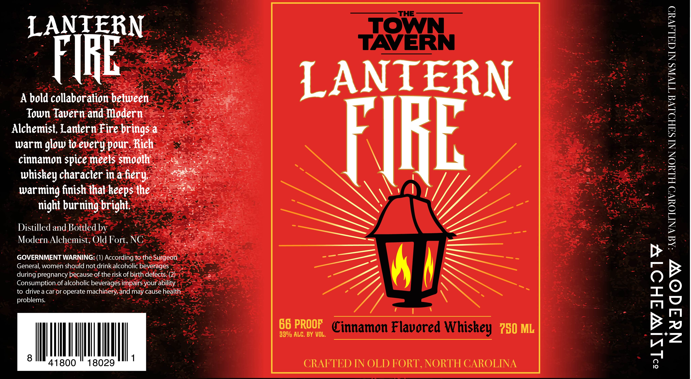

# TTB COLA Label Images - TTBID 26313001000303

**Brand Name:** THE TOWN TAVERN

**Fanciful Name:** LANTERN FIRE

**Issue Date:** 11/18/2026

**Origin Code:** 35

**Product Class/Type:** 149

**Source:** [TTB Public COLA Registry](https://ttbonline.gov/colasonline/viewColaDetails.do?action=publicFormDisplay&ttbid=26313001000303)

## Label Images

### Label 1

## Extracted Label Text

*Text extracted via OCR - may contain errors*

**Detected Proof:** 132

### Label 1

ThE
LANTERN
TOWN
1
TAVERN
FIRE
7
LANTERN
1
A bold collaboration between
Town Tavern and Modern
1
Alchemist, Lantern Fire
a
FIRE
warm glow to every pour: Rich
7
cinnamon spice meets smooth
whiskey character in a fiery
1
warming finish Ihal keeps the
night burning bright
Distilled and
Bottled by
I
Modern Alchemist, Old Fort, NC
GOVERNMENT WARNING: (1) According to the Surgeon
General, women should not drink alcoholic beverages
during pregnancy because of the risk of birth defects:'
0
Consumption of alcoholic beverages impairs your ability
to drive a car or operate machinery, and may cause health
problems
66 PROOF
1
339/ ALC. BY VOL:
Cinnamon Flavored Whiskey 250 ML
8
41800
18029
CRAFTED IN OLD FORT, NORTH CAROLINA
5
brings
