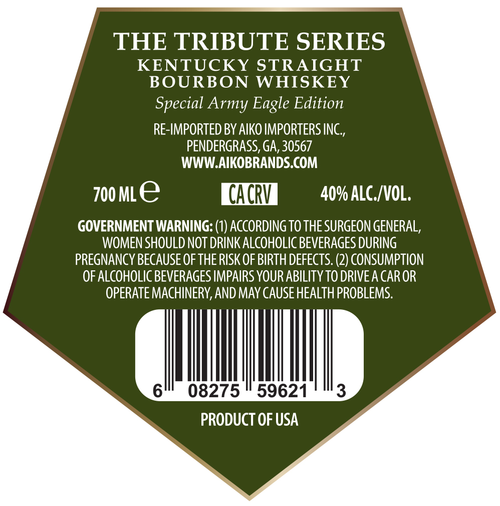
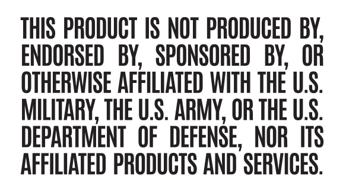
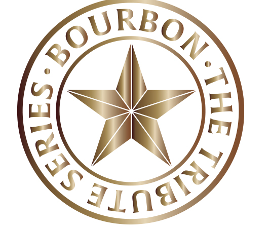

# TTB COLA Label Images - TTBID 26313001000342

**Brand Name:** THE TRIBUTE SERIES

**Issue Date:** 11/12/2026

**Origin Code:** 00

**Product Class/Type:** 101

**Source:** [TTB Public COLA Registry](https://ttbonline.gov/colasonline/viewColaDetails.do?action=publicFormDisplay&ttbid=26313001000342)

## Label Images

### Front Label

### Label 2

### Label 3

## Extracted Label Text

*Text extracted via OCR - may contain errors*

*1 image(s) excluded: text did not meet readability threshold*

**Detected Proof:** 80

### Front Label

THE TRIBUTE SERIES

KENTUCKY STRAIGHT

BOURBON WHISKEY

Special Army Eagle Edition

RE-IMPORTED BY AIKO IMPORTERS INC.,

PENDERGRASS, GA, 30567

WWW.AIKOBRANDS.COM

700 MLE

CACRV

40% ALC,/VOL.

GOVERNMENT WARNING: (1) ACCORDING T0 THE SURGEON GENERAL,

WOMEN SHOULD NOT DRINK ALCOHOLIC BEVERAGES DURING

PREGNANCY BECAUSE OF THE RISK OF BIRTH DEFECTS. (2) CONSUMPTION

OF ALCOHOLIC BEVERAGES IMPAIRS YOUR ABILITY TO DRIVE A CAR OR

OPERATE MACHINERY, AND MAY CAUSE HEALTH PROBLEMS.

6" 08275 * 59621

PRODUCT OF USA

### Label 2

THIS PRODUCT IS NOT PRODUCED BY,

ENDORSED BY, SPONSORED BY, OR

OTHERWISE AFFILIATED WITH THE U.S.

MILITARY, THE U.S. ARMY, OR THE U.S.

DEPARTMENT OF DEFENSE, NOR ITS

AFFILIATED PRODUCTS AND SERVICES.
