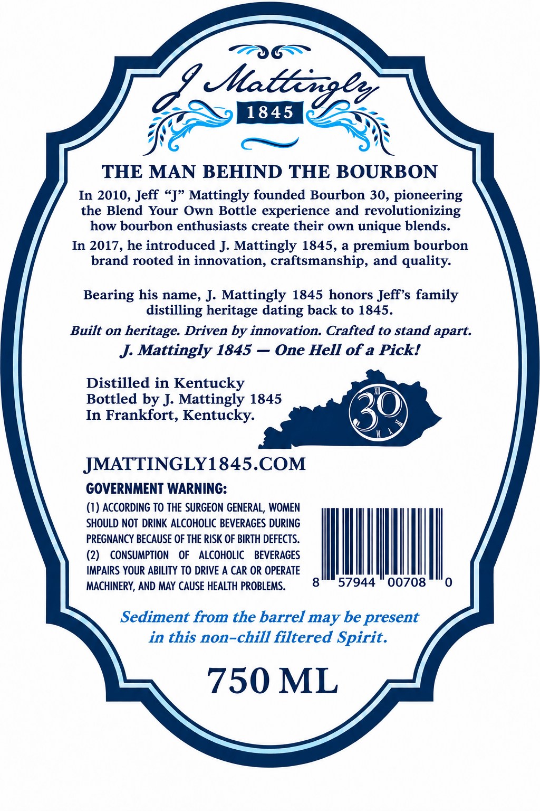
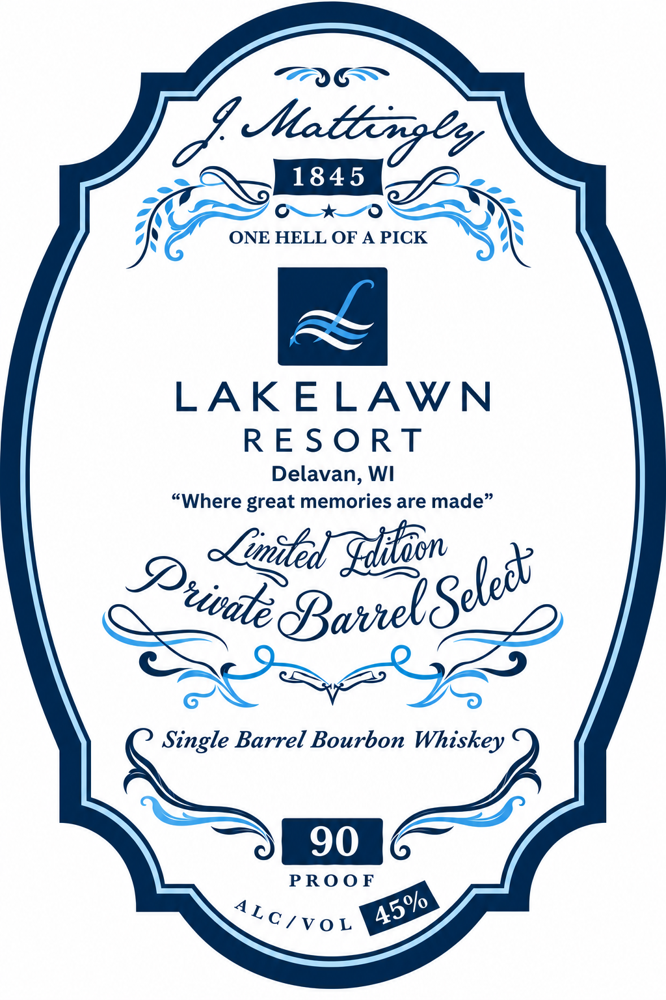

# TTB COLA Label Images - TTBID 26313001000428

**Brand Name:** J. MATTINGLY 1845

**Fanciful Name:** LAKELAWN RESORT

**Issue Date:** 11/20/2026

**Origin Code:** 22

**Product Class/Type:** 141

**Source:** [TTB Public COLA Registry](https://ttbonline.gov/colasonline/viewColaDetails.do?action=publicFormDisplay&ttbid=26313001000428)

## Label Images

### Back Label

### Label 1

## Extracted Label Text

*Text extracted via OCR - may contain errors*

**Detected Proof:** 90

### Back Label

xtatberpe
1845
THE MAN BEHIND THE BOURBON
In 2010, Jeff <J" Mattingly founded Bourbon 30, pioneering
the Blend Your Own Bottle experience and revolutionizing
how bourbon enthusiasts create their own unique blends
In 2017, he introduced J. Mattingly 1845, a premium bourbon
brand rooted in innovation, craftsmanship, and quality:
Bearing his name, J Mattingly 1845 honors Jeff's family
distilling heritage dating back to 1845.
Built on
heritage. Driven by innovation. Crafted to stand apart:
J. Mattingly 1845
S
One Hell of a Pick!
Distilled in Kentucky
Bottled by J Mattingly 1845
In Frankfort, Kentucky:
JMATTINGLY1845.COM
GOVERNMENT WARNING:
(1) ACCORDING TO THE SURGEON GENERAL, WOMEN
SHOULD NOT DRINK ALCOHOLIC BEVERAGES DURING
PREGNANCY BECAUSE OF THE RISK OF BIRTH DEFECTS.
(2)
CONSUMPTION
OF
ALCOHOLIC
BEVERAGES
IMPAIRS YOUR ABILITY TO DRIVE A CAR OR OPERATE
MACHINERY, AND MAY CAUSE HEALTH PROBLEMS.
57944
00708
Sediment from the barrel may be present
in this non-chill filtered Spirit:
750 ML

### Label 1

~Mattae
1845
ONE HELL OF A PICK
LAKELAWN
R E S0 RT
Delavan; WI
"Where great memories are made"
Omiled
Single Barrel Bourbon Whiskey
90
PRo0 F
Sditoon
'Seled:
Puvdlec
Bavele
45%
ALC / Vo L
