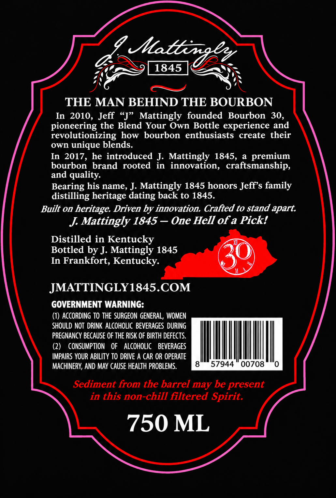
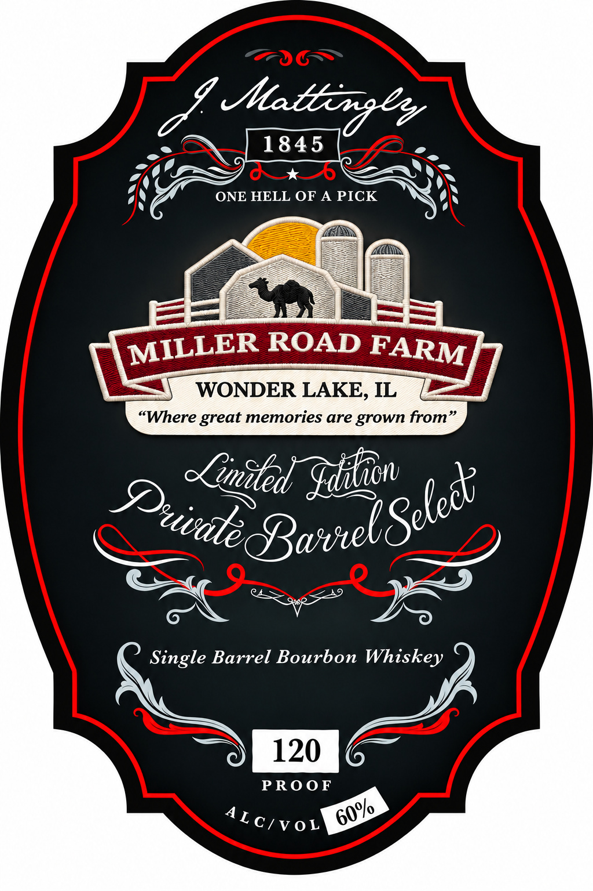

# TTB COLA Label Images - TTBID 26313001000440

**Brand Name:** J. MATTINGLY 1845

**Fanciful Name:** MILLER ROAD FARM

**Issue Date:** 11/18/2026

**Origin Code:** 22

**Product Class/Type:** 141

**Source:** [TTB Public COLA Registry](https://ttbonline.gov/colasonline/viewColaDetails.do?action=publicFormDisplay&ttbid=26313001000440)

## Label Images

### Back Label

### Label 1

## Extracted Label Text

*Text extracted via OCR - may contain errors*

**Detected Proof:** 120

### Back Label

Itattxaea
1845
THE MAN BEHIND THE BOURBON
In 2010, Jeff
'J"
Mattingly  founded
Bourbon 30,
pioneering the Blend Your Own Bottle experience and
revolutionizing how bourbon enthusiasts
create their
own
unique blends.
In 2017, he introduced J. Mattingly 1845,
a
premium
bourbon brand rooted
in innovation, craftsmanship,
and quality.
Bearing his name, J Mattingly 1845 honors Jeff's family
distilling heritage dating back to 1845.
Built on heritage Driven by innovation. Crafted to stand apart.
J. Mattingly 1845
L
One Hell of a Pick!
Distilled in Kentucky
Bottled by J. Mattingly 1845
In Frankfort, Kentucky:
JMATTINGLY1845.COM
GOVERNMENT WARNING:
(1) ACCORDING TO THE  SURGEON GENERAL, WOMEN
SHOULD NOT  DRINK  ALCOHOLIC  BEVERAGES  DURING
PREGNANCY BECAUSE OF THE RISK OF BIRTH DEFECTS:
(2)
CONSUMPTION
OF
ALCOHOLIC   BEVERAGES
IMPAIRS YOUR ABILITY TO DRIVE A CAR OR OPERATE
MACHINERY, AND MAY CAUSE HEALTH PROBLEMS.
57944
00708
0
Sediment from the barrel may be present
in this non-chill filtered Spirit.
750 ML

### Label 1

Matize ee
1845
ONE HELL OF A PICK
ROAD
WONDER LAKE, IL
"Where great memories are grown from
Ximdled
Single Barrel Bourbon Whiskey
120
PRO 0F
MILLER
FARM
Sdilion
Rwvel Seled}
Druvdle
60%
ALC/VoL
