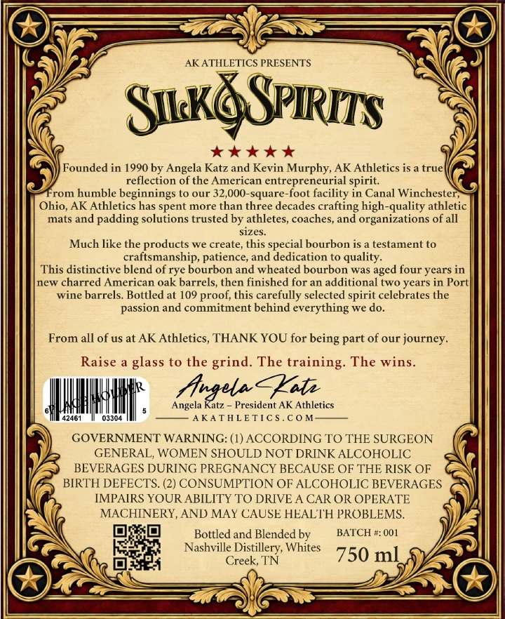
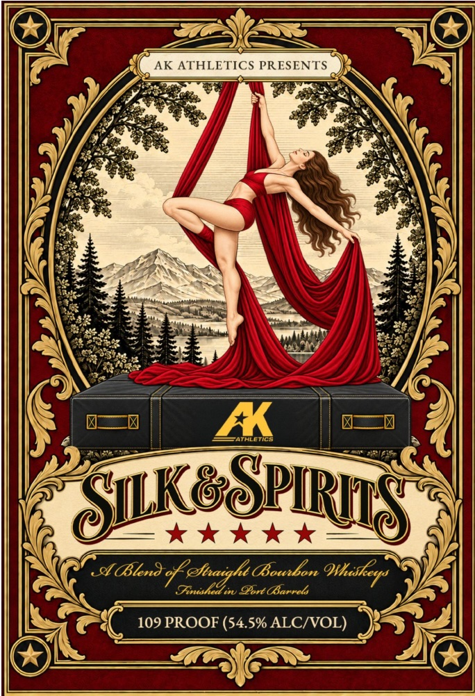

# TTB COLA Label Images - TTBID 26313001000442

**Brand Name:** SILK & SPIRITS

**Issue Date:** 11/13/2026

**Origin Code:** 43

**Product Class/Type:** 121

**Source:** [TTB Public COLA Registry](https://ttbonline.gov/colasonline/viewColaDetails.do?action=publicFormDisplay&ttbid=26313001000442)

## Label Images

### Back Label

### Front Label

## Extracted Label Text

*Text extracted via OCR - may contain errors*

**Detected Proof:** 109

### Back Label

AK ATHLETICS PRESENTS
SuKGSPIRITS
Founded in
990 by Angela Katz and Kevin Murphy, AK Athletics is a truel
reflection of the American entrepreneurial spirit
humble
beginnings to our 32,000-square-foot facility in Canal Winchester;
Ohio, AK Athletics has spent more than three decades
crafting high-quality athletic
mats and padding solutions trusted by athletes, coaches, and organizations of all
sizes_
Much like the products we create; this special bourbon is
lestament t0
craftsmanship, patience, and dedication t0 quality.
This distinctive blend of rye bourbon and wheated bourbon was aged four years in
new charred American oak barrels, then finished for an additional two years in Port
wine barrels. Bottled at 109 proof; this carefully selected spirit celebrates the
passion and commitment behind everything we do
From all of us at AK Athletics, THANK YOU for
part of our journey.
Raise a glass to the
The training: The wins_
Ill
Angela
Argela-Kb
Katz
President AK Athletics
42461
03304
KA THL ETIC $
C 0 M
GOVERNMENT WARNING: (1) ACCORDING TO THE SURGEON
GENERAL, WOMEN SHOULD NOT DRINK ALCOHOLIC
BEVERAGES DURING PREGNANCY BECAUSE OF THE RISK OF
BIRTH DEFECTS: (2) CONSUMPTION OF ALCOHOLIC BEVERAGES
[MPAIRS YOUR ABILITY TO DRIVE A CAR OR OPERATE
MACHINERY, AND MAY CAUSE HEALTH PROBLEMS.
Bottled and Blended by
BATCH #: 001
Nashville Distillery, Whites
Creek; TN
750 ml
From
being
grind.

### Front Label

AK ATHLETICS PRESENTS
~Il BBleno _
 dstaizf
GBorrbon
DU
9ost (Barrebs
109 PROOF (54.5% ALCIVOL)
GPRRAS
Gukoe
OVhiskeys
