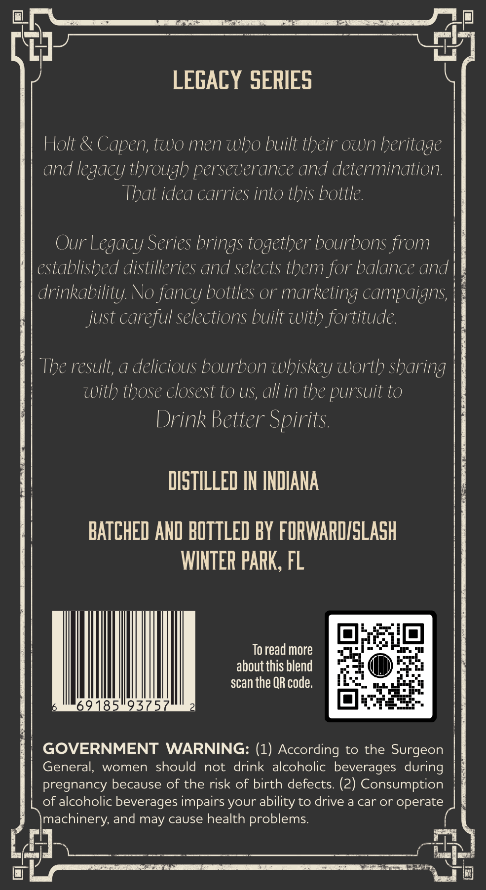
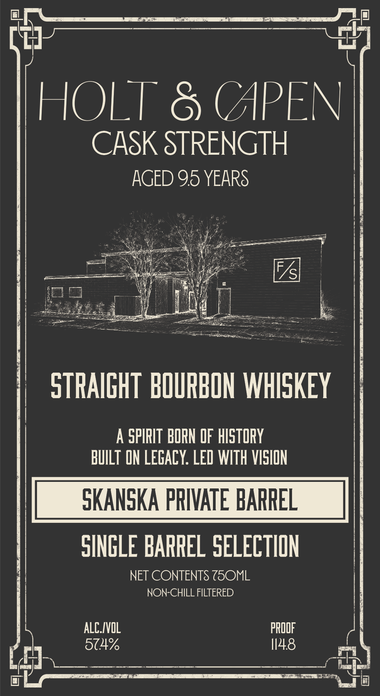

# TTB COLA Label Images - TTBID 26313001000469

**Brand Name:** HOLT & CAPEN CASK STRENGTH

**Issue Date:** 11/16/2026

**Origin Code:** 16

**Product Class/Type:** 101

**Source:** [TTB Public COLA Registry](https://ttbonline.gov/colasonline/viewColaDetails.do?action=publicFormDisplay&ttbid=26313001000469)

## Label Images

### Back Label

### Front Label

## Extracted Label Text

*Text extracted via OCR - may contain errors*

### Back Label

LEGACY SERIES
Holt & Capen; two men who built their own beritage
and legacy through perseverance and determination:
That idea carries into this bottle:
Qur Legacy Series brings together bourbons from
established distilleries and selects them for balance and
drinkability. No fancy bottles or marketing campaigns;
just careful selections built with fortitude
The result;a delicious bourbon whiskey worth sharing
with those closest to US; all in the pursuit to
Drink Better Spirits
DISTILLED IN INDIANA
BATCHED AND BOTTLED BY FORWARDISLASH
WINTER PARK, FL
To read more
about this blend
scan the QR code.
69185"9375
GOVERNMENT
WARNING: (1) According to the Surgeon
General;
women
should
not
drink alcoholic beverages during
pregnancy because of the risk of birth defects (2) Consumption
of alcoholic beverages impairs your ability to drive a car or operate
machinery;
may cause health problems:
and

### Front Label

HOLT 8 (APEN
CASK STRENGTH
AGED 95 YEARS
F
/s
STRAIGHT BOURBON WHISKEY
A
SPIRIT BORN OF hISTORY
BUILT ON LEGAcY: LED WITH VISIN
SKANSKA PRVATE BARREL
SINGLE BARREL SELECTION
NET CONTENTS Z5OML
NON-CHILL FILTERED
ALCIVOL
PROOF
574%
114.8
