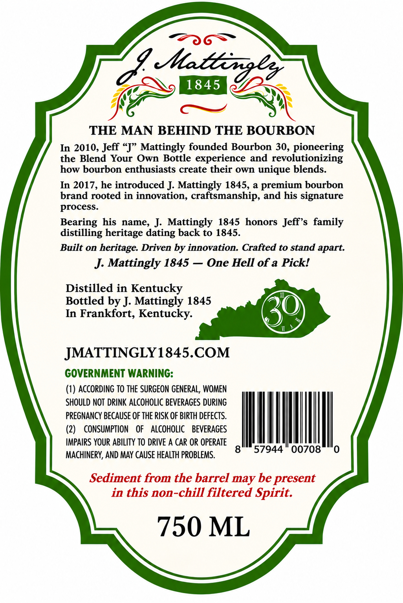
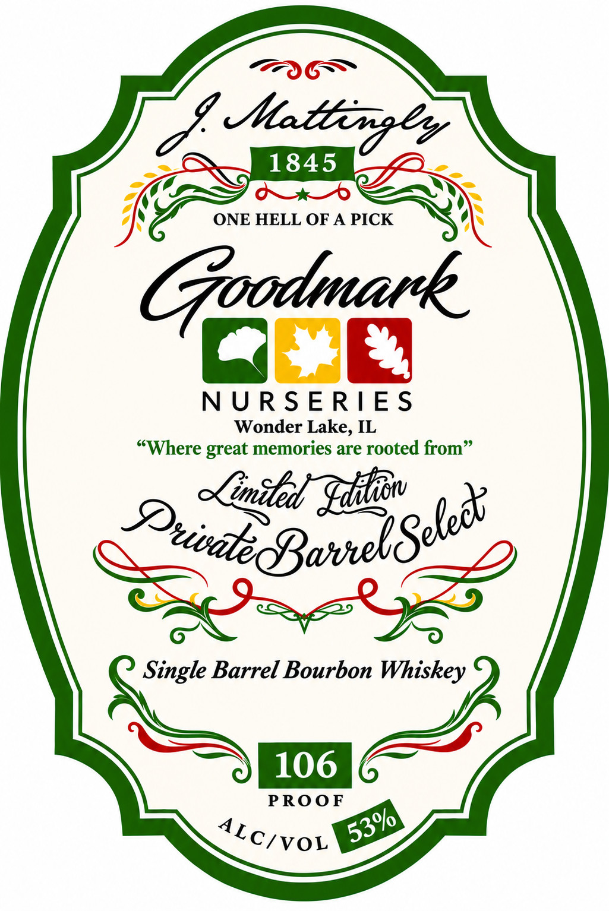

# TTB COLA Label Images - TTBID 26313001000471

**Brand Name:** J. MATTINGLY 1845

**Fanciful Name:** GOODMARK NURSERIES

**Issue Date:** 11/18/2026

**Origin Code:** 22

**Product Class/Type:** 141

**Source:** [TTB Public COLA Registry](https://ttbonline.gov/colasonline/viewColaDetails.do?action=publicFormDisplay&ttbid=26313001000471)

## Label Images

### Back Label

### Label 1

## Extracted Label Text

*Text extracted via OCR - may contain errors*

**Detected Proof:** 106

### Back Label

Mlaflia2
1845
THE MAN BEHIND THE BOURBON
In 2010, Jeff *J" Mattingly founded Bourbon 30, pioneering
the Blend Your Own Bottle experience and revolutionizing
how bourbon enthusiasts create their own unique blends:
In 2017, he introduced J Mattingly 1845, a premium bourbon
brand rooted in innovation, craftsmanship, and his signature
process.
Bearing his name; J Mattingly 1845 honors Jeff's family
distilling heritage
back to 1845.
Built on
heritage. Driven by innovation. Crafted to stand apart:
J. Mattingly 1845
One Hell of a Pickl
Distilled in Kentucky
Bottled by J. Mattingly 1845
In Frankfort; Kentucky
JMATTINGLY1845.COM
GOVERNMENT WARNING:
(1) ACCORDING TO THE SURGEON GENERAL, WOMEN
SHOULD NOT DRINK ALCOHOLIC BEvERAGES DurIng
PREGNANCY BECAUSE OF THE RISK OF BIRTH DEFECTS.
(2)
CONSUMPTION
OF
ALCOHOLIC
BEVERAGES
IMPAIRS YOUR ABILITY TO DRIVE A CAR OR OPERATE
8
57944
00708
MACHINERY, AND MAY CAUSE HEALTH PROBLEMS.
Sediment from the barrel may be present
in this non-chill filtered Spirit:
750 ML
4
dating

### Label 1

Mtatbaev
1845
ONE HELL OF
PICK
Toodmark
N U R SERIE S
Wonder Lake, IL
SWhere
memories are rooted from"
~imiled
2vnaBomotSsek
Single Barrel Bourbon Whiskey
106
PROOF
great
didow
53%]
ALC/VOL
