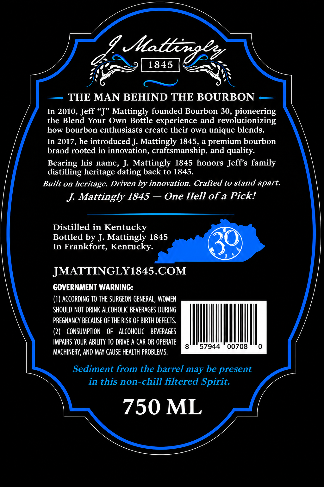
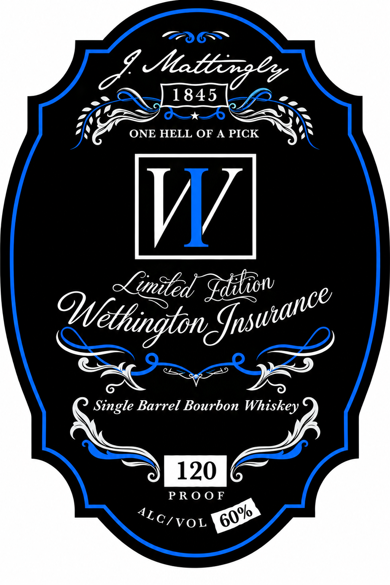

# TTB COLA Label Images - TTBID 26313001000483

**Brand Name:** J. MATTINGLY 1845

**Fanciful Name:** LIMITED EDITION WETHINGTON INSURANCE

**Issue Date:** 11/20/2026

**Origin Code:** 22

**Product Class/Type:** 141

**Source:** [TTB Public COLA Registry](https://ttbonline.gov/colasonline/viewColaDetails.do?action=publicFormDisplay&ttbid=26313001000483)

## Label Images

### Back Label

### Label 1

## Extracted Label Text

*Text extracted via OCR - may contain errors*

**Detected Proof:** 120

### Back Label

Jtathrey
1845
THE MAN BEHIND THE BOURBON
In 2010, Jeff *J" Mattingly founded Bourbon 30, pioneering
the Blend Your Own Bottle experience and revolutionizing
how bourbon enthusiasts create their own unique blends.
In 2017, he introduced J Mattingly 1845, a premium bourbon
brand rooted in innovation, craftsmanship, and quality:
Bearing his name, J Mattingly 1845 honors Jeffs family
distilling heritage
back to 1845.
Built on
heritage. Driven by innovation. Crafted to stand apart.
J. Mattingly 1845
One Hell of a Pick!
Distilled in Kentucky
Bottled by J Mattingly 1845
In Frankfort, Kentucky:
JMATTINGLY1845.COM
GOVERNMENT WARNING:
(1) ACCORDING TO THE SURGEON GENERAL, WOMEN
SHOULD NOT DRINK ALCOHOLIC BEVERAGES DURING
PREGNANCY BECAUSE OF THE RISK OF BIRTH DefECTS.
(2)
CONSUMPTION
OF
ALCOHOLIC
BEVERAGES
IMPAIRS YOUR ABILITy TO DRIVE A CAR OR OPERATE
57944
00708
MACHINERY, AND MAY CAUSe HEALTH PROBLEMS:
Sediment from the barrel may be present
in this non-chill filtered Spirit:
750 ML
dating

### Label 1

Matba ex
1845
ONE HELL OF A PICK
V
Ximiled Fdiionv
Single Barrel Bourbon Whiskey
120
PRO0 0 F
SInsuance
OWethingtonv
60%
ALC /VOL
