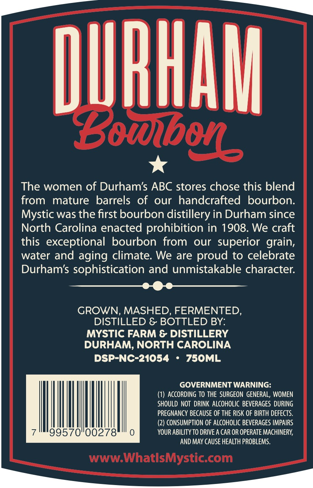
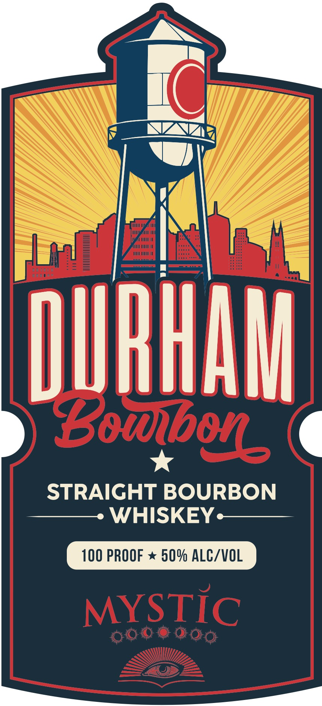

# TTB COLA Label Images - TTBID 26314001000098

**Brand Name:** MYSTIC

**Fanciful Name:** DURHAM BOURBON

**Issue Date:** 11/16/2026

**Origin Code:** 35

**Product Class/Type:** 101

**Source:** [TTB Public COLA Registry](https://ttbonline.gov/colasonline/viewColaDetails.do?action=publicFormDisplay&ttbid=26314001000098)

## Label Images

### Back Label

### Label 1

## Extracted Label Text

*Text extracted via OCR - may contain errors*

**Detected Proof:** 100

### Back Label

IbHI
The women of Durham's ABC stores chose this blend
from
mature barrels
of
our handcrafted
bourbon:
Mystic was the first bourbon distillery in Durham since
North Carolina enacted prohibition in 1908. We craft
this exceptional bourbon from
our
superior grain,
water and aging climate: We are proud to celebrate
Durham's sophistication and unmistakable character
GROWN, MASHED, FERMENTED,
DISTILLED & BOTTLED BY:
MYSTIC FARM & DISTILLERY
DURHAM, NORTH CAROLINA
DSP-NC-21054
75OML
GOVERNMENT WARNING:
ACCORDING TO THE   SURGEON   GENERAL, WOMEN
SHOULD NOT   DRINK  ALCOHOLIC  BEVERAGES DURING
PREGNANCY BECAUSE OF THE RISK OF BIRTH DEFECTS.
(2) CONSUMPTION OF ALCOHOLIC BEVERAGES IMPAIRS
99570"00278
YOUR ABILITY TO DRIVE A CAR OR OPERATE MACHINERY,
AND MAY CAUSE HEALTH PROBLEMS.
www.WhatlsMystic.com

### Label 1

bha
STRAIGHT BOURBON
WHISKEY
100 PROOF
509 ALC/VOL
MYSTic
