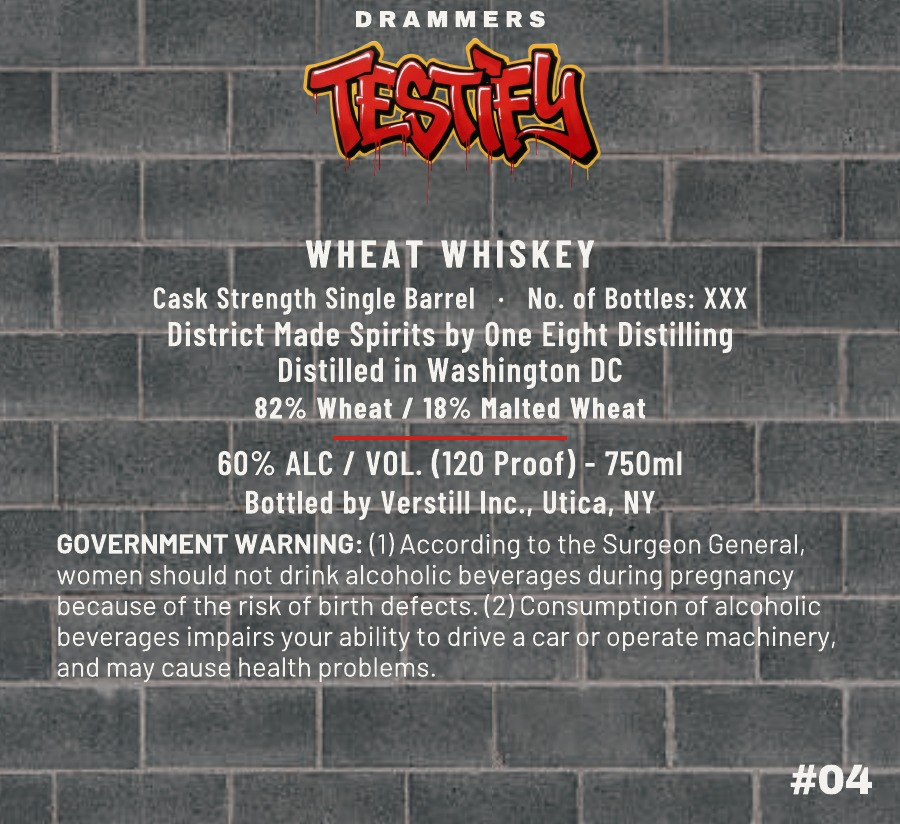
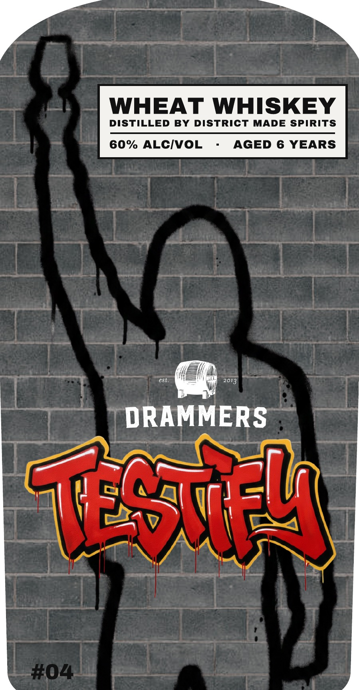

# TTB COLA Label Images - TTBID 26314001000320

**Brand Name:** DRAMMERS

**Fanciful Name:** TESTIFY

**Issue Date:** 11/17/2026

**Origin Code:** 02

**Product Class/Type:** 140

**Source:** [TTB Public COLA Registry](https://ttbonline.gov/colasonline/viewColaDetails.do?action=publicFormDisplay&ttbid=26314001000320)

## Label Images

### Back Label

### Front Label

## Extracted Label Text

*Text extracted via OCR - may contain errors*

**Detected Proof:** 120
**Detected Age:** 6 Years

### Back Label

D RAMMERS
Texh
WHEAT WHISKEY
Cask Strength Single Barrel
No. of Bottles: XXX
District Made Spirits by One Eight Distilling
Distilled in Washington DC
82% Wheat
18% Malted Wheat
60% ALC / VOL. (120 Proof)
750ml
Bottled by Verstill Inc , Utica, NY
GOVERNMENT WARNING: (1) According to the Surgeon General,
women should not drink alcoholic beverages during pregnancy
because of the risk of birth defects. (2) Consumption of alcoholic
beverages impairs your ability to drive a car or operate machinery,
and may cause health problems.
#04

### Front Label

WHEAT WHISKEY
DISTILLED
BY
DISTRICT
MADE SPIRITS
60% ALCIVOL
AGED 6
YEARS
esb,
2013
DRAMMERS
Wen h
#04
